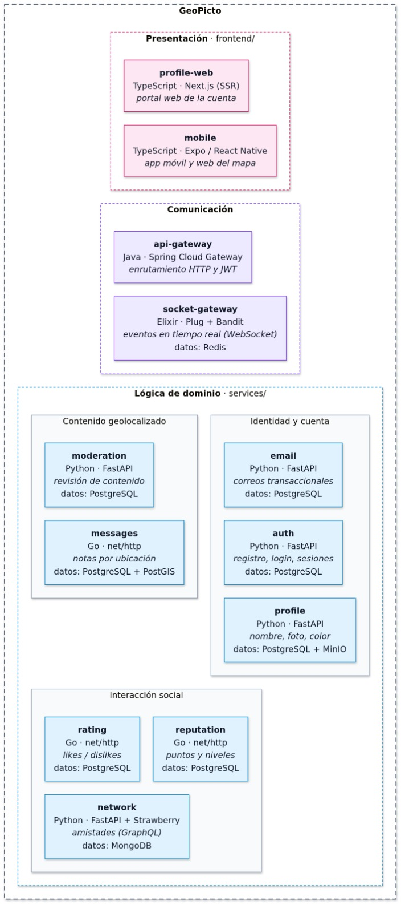

# Prototipo 2 — Estructura arquitectónica avanzada

**Curso:** Software Architecture — 2026-II  
**Equipo:** 2F  
**Sistema:** GeoPicto

## Equipo

Equipo 2F, conformado por los estudiantes:

- Sergio Andres Hernández Salinas
- Juan Esteban Medina Cardenas
- Juan Pablo Barreto Hernández
- Juan Esteban Santacruz Corredor
- Andres Felipe Ramirez Fajardo
- Cristian Felipe Ramirez Montenegro
- Diego Fernando Mellizo Pedraza
- Julian Santiago Becerra Pulido

## Sistema de software

### Nombre

**GeoPicto**

### Logo


### Descripción

Nuestro proyecto lleva por nombre GeoPicto y consiste en una red social de mensajes geoespaciales
contextuales, en la cual los usuarios pueden crear, descubrir y valorar mensajes asociados a ubicaciones
específicas. La aplicación busca integrar las características de una red social con la geolocalización,
permitiendo que los usuarios interactúen con contenido creado por otras personas dependiendo de su
proximidad.

## Estructuras arquitectónicas

### Estructura de Componentes y Conectores (C&C)

#### Vista C&C


#### 3.1.2 Convenciones del diagrama

| Elemento gráfico | Significado |
| --- | --- |
| Rectángulo | Componente en ejecución (contenedor Docker), con su lenguaje, framework y responsabilidad. |
| Cilindro | Componente de datos: motor de base de datos, almacenamiento de objetos |
| Flecha roja | Conector HTTP de tipo REST. |
| Flecha azul| Conector GraphQL. |
| Flecha morada| Conector REST y GraphQL. |
| Linea verde| Conector Websocket. Canal persistente para notificaciones en tiempo real. |
| Línea discontinua| Evento de dominio publicado o consumido a través de RabbitMQ. |
| Linea sin etiqueta de un servicio a un cilindro | Acceso del servicio a su propio almacenamiento. |

#### 3.1.3 Elementos arquitectónicos y relaciones

La vista distingue dos formas de comunicación: la síncrona, que pasa por el `api-gateway`, y la asíncrona, que usa RabbitMQ como bus de eventos. Los servicios de lógica no se llaman directamente entre sí para completar un caso de negocio; cuando necesitan reaccionar a un cambio, publican o consumen eventos.

##### Componentes de presentación y comunicación

| Componente | Tipo | Tecnología | Responsabilidad | Interfaces |
| --- | --- | --- | --- | --- |
| `frontend` | Presentación | TypeScript, Expo 57, React Native/React Native Web, MapLibre dentro de WebView, Nginx | Aplicación móvil y web: mapa, notas cercanas, autenticación, amigos, calificaciones y notificaciones. Se sirve como SPA estática. | Interfaz gráfica; REST, GraphQL y WebSocket contra el gateway. |
| `profile-web` | Presentación web SSR | TypeScript, Next.js 16.4, React 19.3, Server Components y Server Actions | Panel de cuenta renderizado en el servidor: perfil, avatar, mensajes, reputación y red de amigos. Los JWT se guardan en cookies httpOnly y el servidor de Next habla con el gateway. | HTML/RSC al navegador; REST y GraphQL desde el servidor Next; Server Actions para mutaciones. |
| `api-gateway` | Comunicación y orquestación síncrona | Java 21, Spring Boot 4, Spring Cloud Gateway WebFlux, jjwt | Punto único de entrada HTTP. Enruta, valida JWT, elimina `X-User-ID` enviado por el cliente, agrega la identidad confiable, aplica CORS y expone `/actuator/health`. | HTTP público en `:8080`; HTTP interno hacia los servicios. |
| `rabbitmq` | Comunicación y orquestación asíncrona | RabbitMQ 4, exchange `topic` `geopicto.events` | Transporta eventos de dominio entre productores y consumidores. Permite desacoplar la moderación, el correo, la reputación y el tiempo real. | AMQP en `:5672`; consola de administración interna. |

##### Componentes de lógica

| Componente | Tipo | Tecnología | Responsabilidad | Interfaces y datos |
| --- | --- | --- | --- | --- |
| `auth` | Lógica | Python 3.13, FastAPI, SQLAlchemy, Argon2id, PyJWT | Registro, login, emisión de access token JWT, refresh token rotativo, sesiones revocables, bloqueo por intentos fallidos y cambio de contraseña. | REST bajo `/auth/*`; publica `user.registered.v1`; base `auth-db`. |
| `messages` | Lógica | Go 1.27, `net/http`, PostgreSQL + PostGIS | Publica notas con coordenadas, consulta por proximidad, consulta y elimina mensajes propios y aplica la decisión de moderación. | REST bajo `/messages/*`; publica `message.submitted.v1`, `message.published.v1` y `message.deleted.v1`; consume `moderation.completed.v1` y `moderation.failed.v1`; base `messages-db`. |
| `moderation` | Lógica y proceso asíncrono | Python 3.13, FastAPI, reglas YAML y cliente de OpenAI | Consume mensajes recién creados, decide `ALLOW`, `WARN` o `BLOCK`, guarda la auditoría y responde por el broker. No publica ni edita mensajes. | Consume `message.submitted.v1`; publica `moderation.completed.v1` y `moderation.failed.v1`; API interna `/internal/*`; base `moderation-db`. |
| `network` | Lógica | Python 3.13, FastAPI, Strawberry GraphQL, MongoDB | Gestiona solicitudes de amistad, aceptación, rechazo, cancelación, eliminación y consulta de amigos. | GraphQL bajo `/graphql`; publica `activity.created.v1` y `notification.requested.v1`; base `network-db`. |
| `profile` | Lógica | Python 3.13, FastAPI, SQLAlchemy, MinIO, Pillow | Mantiene nombre visible, descripción, color y avatar. Resuelve perfiles por lote y busca por nombre o username. | REST bajo `/profiles/*`; consume `user.registered.v1`, `user.updated.v1` y `user.deleted.v1`; publica `profile.updated.v1`; base `profile-db` y bucket `profile_avatars` en MinIO. |
| `rating` | Lógica | Go 1.27, PostgreSQL, `pgx` | Registra likes y dislikes, mantiene conteos por mensaje y una proyección de los mensajes publicados. | REST bajo `/ratings/*`; consume `message.published.v1` y `message.deleted.v1`; publica `rating.changed.v1`; base `rating-db`. |
| `reputation` | Lógica y proceso asíncrono | Go 1.27, PostgreSQL | Calcula puntaje, nivel y progreso; mantiene un ledger idempotente y expone historial y leaderboard. | REST bajo `/reputation/*`; consume `rating.changed.v1` y `moderation.completed.v1`; publica `reputation.changed.v1`; base `reputation-db`. |
| `email` | Lógica y proceso asíncrono | Python 3.13, FastAPI, Jinja2, `aiosmtplib`, SMTP | Envía correos transaccionales fuera de la petición HTTP, con plantillas registradas, idempotencia, reintentos y cola de descarte. | Consume `user.registered.v1` y `email.requested.v1`; publica `email.sent.v1` y `email.failed.v1`; API interna `/internal/emails`; base `email-db`; SMTP contra Mailpit. |
| `socket-gateway` | Lógica y proceso asíncrono | Elixir 1.18, OTP, Bandit, Plug, WebSockAdapter, Redix, AMQP | Emite tickets efímeros, mantiene conexiones WebSocket, gestiona suscripciones a tópicos y hace fanout de eventos con Redis Pub/Sub. | `POST /tickets`, `GET /ws`, `/health`, `/metrics`; consume `socket.events.q`; usa Redis. |

##### Componentes de datos y soporte

| Componente | Tipo | Tecnología | Responsabilidad | Propietario / uso |
| --- | --- | --- | --- | --- |
| `auth-db` | Datos relacionales | PostgreSQL 18 | Usuarios, credenciales, sesiones y refresh tokens hasheados. | Solo `auth`. |
| `messages-db` | Datos relacionales + geoespaciales | PostgreSQL 18 + PostGIS 3.6 | Mensajes, estado de moderación, versión y ubicación `GEOGRAPHY(Point, 4326)` con índice GiST. | Solo `messages`. |
| `moderation-db` | Datos relacionales | PostgreSQL 18 | Decisiones de moderación, razones, versión del modelo y auditoría. | Solo `moderation`. |
| `network-db` | Datos NoSQL documentales | MongoDB 8 | Colección `friendships` con la pareja de usuarios, estado, quién envió la solicitud y fechas. | Solo `network`. |
| `profile-db` | Datos relacionales | PostgreSQL 18 | Perfil público, nombre visible, descripción, color y referencia del avatar. | Solo `profile`. |
| `rating-db` | Datos relacionales | PostgreSQL 18 | Votos, estadísticas por mensaje y proyección de mensajes publicados. | Solo `rating`. |
| `reputation-db` | Datos relacionales | PostgreSQL 18 | Reputación agregada por usuario y ledger inmutable de movimientos. | Solo `reputation`. |
| `email-db` | Datos relacionales | PostgreSQL 18 | Registro de envíos, estado, reintentos e idempotencia. | Solo `email`. |
| `minio` | Datos de objetos | MinIO compatible con S3 | Avatares WebP en el bucket privado `geopicto-avatars`. | Solo `profile`. |
| `redis` | Datos en memoria | Redis 7 | Tickets de un solo uso, presencia y Pub/Sub para el fanout de tiempo real. | `socket-gateway`. |
| `mailpit` | Soporte de desarrollo | Mailpit | Servidor SMTP local y bandeja web para inspeccionar los correos del prototipo. | `email`. |

##### Conectores

| Conector | Desde → hacia | Estilo | Detalle |
| --- | --- | --- | --- |
| Navegación | Usuario → `frontend` / `profile-web` | HTTPS | El usuario abre la SPA o el panel SSR en el navegador. |
| API del cliente | `frontend` → `api-gateway` | REST, GraphQL y WebSocket | El JWT viaja en `Authorization: Bearer`; el WebSocket usa un ticket efímero. |
| API del servidor SSR | `profile-web` → `api-gateway` | HTTP REST y GraphQL | La llamada la hace el servidor de Next.js; el navegador no ve el token de acceso. |
| Autenticación | `api-gateway` → `auth` | REST | `/api/auth/**` se reescribe a `/auth/**`. Es la ruta pública donde se obtiene el JWT. |
| Mensajes | `api-gateway` → `messages` | REST | `/api/messages/**`; `GET /nearby` es pública y el resto exige JWT. |
| Amistades | `api-gateway` → `network` | GraphQL | `/api/network/graphql` se reescribe a `/graphql`. |
| Perfiles | `api-gateway` → `profile` | REST | `/api/profiles/**`; la ruta de avatares es pública para que las etiquetas `` puedan cargarla. |
| Calificaciones | `api-gateway` → `rating` | REST | `/api/ratings/**`. |
| Reputación | `api-gateway` → `reputation` | REST | `/api/reputation/**`. |
| Tiempo real | `api-gateway` → `socket-gateway` | HTTP y WebSocket | `POST /api/socket/tickets` obtiene el ticket; `/api/ws` hace el proxy del handshake. |
| Persistencia | Servicio → base propia | SQL, S3 o Redis | Cada servicio accede únicamente a su almacenamiento; no hay acceso cruzado entre bases. |
| Eventos | Servicios ↔ `rabbitmq` | AMQP | Publicación y consumo de eventos de dominio con el sobre común. |
| Correo | `email` → `mailpit` / SMTP | SMTP | En local se entrega en Mailpit; con configuración externa puede usar un relay autenticado. |

##### Eventos de dominio

| Productor | Evento | Consumidores y efecto |
| --- | --- | --- |
| `auth` | `user.registered.v1` | `profile` crea el perfil inicial; `email` envía el correo de bienvenida. |
| `messages` | `message.submitted.v1` | `moderation` evalúa el contenido. |
| `moderation` | `moderation.completed.v1` | `messages` aplica la decisión; `reputation` ajusta el puntaje; `socket-gateway` notifica el resultado. |
| `moderation` | `moderation.failed.v1` | `messages` aplica la política de fallo configurada. |
| `messages` | `message.published.v1` | `rating` actualiza su proyección; `socket-gateway` lo publica en el tópico global y del autor. |
| `messages` | `message.deleted.v1` | `rating` marca el mensaje como eliminado; `socket-gateway` lo notifica. |
| `rating` | `rating.changed.v1` | `reputation` actualiza el puntaje; `socket-gateway` notifica el cambio. |
| `reputation` | `reputation.changed.v1` | `socket-gateway` notifica el nuevo nivel. |
| `network` | `activity.created.v1` / `notification.requested.v1` | `socket-gateway` entrega avisos de amistad al usuario correspondiente. |
| `profile` | `profile.updated.v1` | `socket-gateway` notifica cambios de perfil. |
| `email` | `email.sent.v1` / `email.failed.v1` | Eventos de auditoría y observabilidad del envío. |

Los eventos usan un sobre común con `eventId`, `eventType`, `version`, `occurredAt`, `producer`, `correlationId`, `causationId` y `payload`. El exchange es `topic` y cada consumidor declara su propia cola y su binding por routing key. Los consumidores aplican idempotencia, confirmación manual y reintentos; `email` usa colas de espera con TTL y una DLQ, y `moderation` usa reintentos con backoff antes de publicar un fallo.

##### Relaciones y restricciones

1. El usuario solo conoce los puertos publicados: `8080` (gateway), `8081` (frontend), `8082` (panel SSR) y `8025` (Mailpit). Los servicios de lógica, las bases, RabbitMQ, Redis y MinIO no se publican al host.
2. El gateway es el único punto de entrada HTTP. No existe una ruta pública directa a `moderation`, `email`, `rating`, `reputation` ni `socket-gateway`.
3. El gateway valida la firma HS256, `exp`, `iss` y que `sub` sea un UUID. Elimina cualquier `X-User-ID` enviado por el cliente y agrega el valor confiable del `sub`.
4. `messages`, `network` y `profile` vuelven a validar el JWT por su cuenta (defensa en profundidad). `rating` y `reputation` confían en el `X-User-ID` del gateway. `socket-gateway` autentica el WebSocket con un ticket efímero de un solo uso.
5. Cada servicio es dueño exclusivo de su base. No hay claves foráneas ni consultas entre bases; la relación entre datos de distintos servicios se hace por UUID.
6. La comunicación entre servicios de lógica es asíncrona y pasa por RabbitMQ. Las únicas interfaces internas síncronas son las de operación y prueba de `moderation` y `email`, protegidas con `X-Internal-Token`.
7. Los consumidores son idempotentes y los fallos transitorios se reintentan. El prototipo no implementa patrón outbox: la publicación ocurre después del commit y, si RabbitMQ está caído, el evento puede perderse aunque la operación principal quede persistida.
8. `moderation` funciona con reglas determinísticas si no hay `OPENAI_API_KEY`; en ese caso marca la decisión como degradada. `messages` aplica `FAIL_OPEN` por defecto y puede configurarse con `FAIL_CLOSED`.
9. `profile-web` no guarda JWT en JavaScript: usa cookies httpOnly y renueva el access token en el servidor antes del render SSR. La SPA móvil usa el header `Authorization` y renueva el token desde el cliente.

#### Estilos y patrones arquitectónicos utilizados

1. **Cliente-servidor distribuido.** El navegador y los dispositivos son clientes; los contenedores son servidores independientes. No comparten memoria ni sistema de archivos: toda interacción ocurre por HTTP, WebSocket, AMQP o acceso a un almacenamiento propio.
2. **Microservicios con base de datos por servicio.** Cada servicio tiene una responsabilidad de dominio delimitada, se construye y despliega por separado y es dueño de su esquema. Esto permite elegir el motor adecuado: PostgreSQL para datos estructurados, PostGIS para proximidad, MongoDB para amistades, Redis para estado efímero y MinIO para objetos.
3. **API Gateway y gateway offloading.** El `api-gateway` centraliza el enrutamiento, la validación del JWT, la eliminación de cabeceras falsificadas, la inyección de identidad y CORS. Los servicios de lógica no tienen que exponer una superficie pública ni repetir la política de borde.
4. **Arquitectura orientada a eventos (event-driven architecture).** RabbitMQ desacopla a los productores de los consumidores. El flujo de moderación es una coreografía: `messages` publica, `moderation` decide, `messages` aplica y `reputation` y `socket-gateway` reaccionan. No hay un orquestador central que ejecute los pasos.
5. **Procesamiento asíncrono y workers.** `moderation`, `email`, `reputation` y `socket-gateway` consumen eventos fuera del ciclo de la petición. La creación de un mensaje no espera a que se envíe un correo ni a que se actualice la reputación; el cliente recibe el resultado por evento o por consulta posterior.
6. **SSR y Backend for Frontend (BFF).** `profile-web` es una capa de presentación que ejecuta la carga de datos en el servidor de Next.js, compone la información del gateway y entrega HTML ya renderizado. Los Server Actions encapsulan las mutaciones y las cookies httpOnly mantienen el token fuera del navegador.
7. **REST, GraphQL y WebSocket.** REST se usa para recursos y acciones simples; GraphQL se usa en `network` porque una sola consulta combina amigos, solicitudes recibidas y enviadas; WebSocket se usa para notificaciones y cambios en tiempo real. Los tres estilos están detrás del gateway.
8. **Persistencia políglota.** La elección de motor responde al tipo de dato: PostgreSQL/PostGIS para mensajes y datos transaccionales, MongoDB para documentos de amistad, Redis para tickets/presencia/pub-sub y MinIO para avatares. No se fuerza un único motor para todo el sistema.
9. **Autenticación sin estado con refresh rotativo.** El access token JWT es verificado localmente por el gateway y por tres servicios; el refresh token es opaco, rotativo y se guarda hasheado en `auth-db`. El logout revoca la sesión en `auth`, aunque el access token sigue siendo válido hasta su expiración corta.
10. **Idempotencia, reintentos y DLQ.** Los consumidores registran o deduplican por identificador; los fallos transitorios se reintentan y los definitivos se derivan a una cola de descarte. `email` implementa esperas con TTL y `moderation` aplica backoff antes de declarar el fallo.
11. **Proyecciones de lectura.** `rating` mantiene una proyección de mensajes publicados para validar votos y `reputation` mantiene un ledger y una tabla agregada. Son vistas materializadas por eventos, no consultas directas a la base de otro servicio.
12. **Arquitectura por capas dentro de cada servicio.** Los servicios de lógica separan adaptadores de entrada, casos de uso, dominio y persistencia. Los servicios Go usan `handler → service → repository/domain`; los servicios Python usan `handler/GraphQL → service → repository/storage/messaging → domain`.
13. **Despliegue container-first.** Cada componente se construye como una imagen y se ejecuta en su propio contenedor. La configuración llega por variables de entorno y el sistema se levanta de forma reproducible con Docker Compose.

### Estructura de despliegue

#### 3.2.1 Vista de despliegue


#### 3.2.2 Elementos arquitectónicos y relaciones

| Elemento | Descripción |
| --- | --- |
| Device | Máquina física con Docker Engine y Docker Compose. Es el único punto desde el que se publican puertos. |
| Red bridge interna | Red privada creada por Compose. Los contenedores se resuelven por el nombre del servicio (`gateway`, `auth`, `messages-db`, `rabbitmq`, etc.). |
| Contenedores publicados | `frontend`, `profile-web`, `gateway` y `mailpit`. Solo estos exponen puertos al host. |
| Contenedores internos | Los 9 servicios de lógica y los 11 componentes de datos/soporte. No tienen puertos publicados. |
| Volúmenes nombrados | `auth_data`, `messages_data`, `moderation_data`, `network_data`, `profile_data`, `profile_avatars`, `rating_data`, `reputation_data` y `email_data`. Conservan los datos entre reinicios y eliminaciones de contenedores. |
| Healthchecks | Cada contenedor con dependencias comprueba su salud con HTTP, `pg_isready`, `redis-cli`, `rabbitmq-diagnostics` o `mongosh`. Compose espera `service_healthy` antes de arrancar dependientes. |
| Política de reinicio | `restart: unless-stopped` en los contenedores de larga duración. |

##### Puertos publicados

| Puerto del host | Contenedor | Uso |
| --- | --- | --- |
| `8080` | `gateway` | API Gateway, punto único de entrada HTTP. |
| `8081` | `frontend` | Aplicación web/móvil servida por Nginx. |
| `8082` | `profile-web` | Panel SSR de cuenta. |
| `8025` | `mailpit` | Bandeja web de correos de desarrollo. |

Los puertos internos (`5432`, `27017`, `5672`, `6379`, `9000`, `8080` de cada servicio) no se publican al host. En particular, las bases de datos y RabbitMQ solo son alcanzables desde la red de Compose.

##### Relaciones de despliegue

- El host publica únicamente los cuatro puertos de la tabla anterior; el resto del sistema queda detrás de la red bridge.
- `frontend` y `profile-web` dependen del gateway sano. El navegador llega a ellos por `8081` y `8082`; el servidor de `profile-web` llega al gateway por `http://gateway:8080`.
- El gateway depende de `auth`, `messages`, `network`, `profile`, `rating`, `reputation` y `socket-gateway`; a su vez, cada servicio espera su base y, cuando aplica, RabbitMQ.
- `profile` espera `profile-db`, `minio` y `rabbitmq`; `socket-gateway` espera `redis` y `rabbitmq`; `email` espera `email-db`, `mailpit` y `rabbitmq`.
- Los volúmenes se montan en las rutas de datos de cada motor. `profile_avatars` se monta en MinIO y `*_data` en la base correspondiente.
- Las imágenes que lo requieren usan etapas separadas de compilación y ejecución. `frontend` termina en Nginx; `profile-web` termina en un servidor Node standalone; los servicios Go y Java de producción usan imágenes mínimas de ejecución.

#### 3.2.3 Patrones de despliegue utilizados

1. **Un contenedor por componente.** Cada servicio, base, broker y frontend tiene su propio ciclo de vida, imagen y healthcheck. Esto permite reiniciar o escalar un componente sin reconstruir todo el sistema.
2. **Red privada con puertos de borde.** Solo la capa de presentación, el gateway y la consola de correo se publican. Las bases y los servicios internos no son accesibles desde fuera de la red de Compose.
3. **Descubrimiento por DNS de Compose.** Los servicios usan nombres estables (`auth-db`, `rabbitmq`, `profile`) en lugar de direcciones IP. La topología se declara en el compose y no se codifica en el código.
4. **Construcciones multi-stage.** Varias imágenes separan la etapa de compilación (Maven, Go, Node, Elixir, Python) de la etapa de ejecución. El artefacto final contiene solo lo necesario para correr.
5. **Configuración por variables de entorno.** JWT, broker, bases, MinIO, SMTP, CORS, orígenes WebSocket y tokens internos se inyectan desde el compose o desde `.env`. El valor por defecto de `JWT_SECRET` es solo para el prototipo local.
6. **Healthchecks y orden de arranque.** `depends_on` con `condition: service_healthy` evita que un servicio arranque contra una base que aún no está lista. `restart: unless-stopped` recupera fallos transitorios.
7. **Persistencia con volúmenes nombrados.** Los datos sobreviven a `docker compose down`; solo se eliminan con `docker compose down -v`. Los avatares quedan en un volumen separado del resto de los datos.
8. **Adaptadores para servicios externos.** MinIO se usa mediante una interfaz compatible con S3; Mailpit se usa como SMTP local y puede reemplazarse por un relay real con variables de entorno. El código no depende de un proveedor cloud específico.
9. **Entrega estática y SSR separados.** `frontend` se compila como exportación web y se sirve con Nginx; `profile-web` se ejecuta como servidor Node para poder renderizar en el servidor y refrescar tokens antes del render.
10. **Prototipo portable, no atado a Kubernetes.** La orquestación se resuelve con Docker Compose. La separación en contenedores y las variables de entorno permiten migrar posteriormente a un orquestador de contenedores sin cambiar la lógica de dominio.

### Estructura por capas

#### Vista por capas


#### Descripción de los elementos arquitectónicos

La vista organiza el sistema en cuatro capas macro. Cada capa agrupa componentes con el mismo nivel de abstracción y la relación entre capas es **allowed-to-use below**: una capa solo puede usar los servicios de la capa inmediatamente inferior y nunca los de una capa superior.

##### Capa 1: Presentación / Clientes

| Elemento | Tecnología | Responsabilidad |
| --- | --- | --- |
| `geopicto-mobile` (`frontend/mobile`) | TypeScript, Expo, React Native | Aplicación móvil iOS/Android (y su versión web) con geolocalización nativa: mapa, notas cercanas, amigos, calificaciones y notificaciones. |
| `geopicto-web` (`frontend/profile-web`) | TypeScript, Next.js, React | Panel web de cuenta con renderizado en el servidor (SSR) e hidratación en el cliente. |

Esta capa solo conoce al gateway. Se comunica con la capa 2 mediante HTTPS usando REST, GraphQL y WebSocket.

##### Capa 2: Borde, enrutamiento y seguridad

| Elemento | Tecnología | Responsabilidad |
| --- | --- | --- |
| `api-gateway` | Java 21, Spring Cloud Gateway | Punto único de entrada. Valida criptográficamente el JWT, inyecta la cabecera confiable `X-User-ID` y enruta dinámicamente cada petición al servicio de negocio correspondiente. |

La capa 2 usa la capa 3 por HTTP interno, siempre con la cabecera `X-User-ID`, además de GraphQL y WebSocket (proxy del handshake hacia el servicio de tiempo real).

##### Capa 3: Servicios de negocio / Microservicios

Cada microservicio es un corte vertical: contiene su propia lógica de negocio y su propio acceso a datos, y no depende de otros servicios de la misma capa para resolver una petición.

| Elemento | Tecnología | Responsabilidad |
| --- | --- | --- |
| `auth` | Python, FastAPI | Identidad, emisión de JWT, sesiones y hash de contraseñas con Argon2id. |
| `messages` | Go, `net/http` | Mensajes geolocalizados; la consulta de cercanía usa `ST_DWithin` de PostGIS. |
| `network` | Python, Strawberry GraphQL | Grafo de amistades expuesto como API GraphQL. |
| `profile` | Python, FastAPI | Datos públicos del usuario: nombre visible, avatar y color. |
| `rating` | Go, `net/http` | Likes y dislikes por mensaje; emite `rating.changed.v1`. |
| `reputation` | Go, `net/http` | Puntaje acotado entre 0 y 1000, niveles y ledger de movimientos. |
| `moderation` | Python, FastAPI | Clasifica el texto de los mensajes como `ALLOW`, `WARN` o `BLOCK` con reglas y, si está configurado, un modelo de OpenAI. |
| `realtime` (`socket-gateway`) | Elixir, Bandit | Notificaciones push en vivo por WebSocket, canales (tópicos) y presencia. |
| `email` | Python, FastAPI (worker asíncrono) | Correos de bienvenida y notificaciones transaccionales. |

La capa 3 usa la capa 4 mediante conexiones TCP privadas: SQL (`5432`), MongoDB (`27017`), AMQP (`5672`) y Redis (`6379`).

##### Capa 4: Persistencia, datos e infraestructura

| Elemento | Tecnología | Responsabilidad |
| --- | --- | --- |
| Bases de datos relacionales | PostgreSQL 18, PostGIS 3.6 | `auth-db`, `messages-db`, `moderation-db`, `profile-db`, `rating-db`, `reputation-db` y `email-db`. Cada una pertenece a un único servicio. |
| Base NoSQL documental | MongoDB 8 | `network-db`, con la colección `friendships`. |
| Broker de mensajería asíncrona | RabbitMQ 4 | Exchange `topic` `geopicto.events` con colas durables y confirmación (ACK) manual. Es el medio por el que los servicios de la capa 3 se comunican entre sí. |
| Caché y presencia en memoria | Redis 7 | Almacén del servicio de tiempo real: tickets de conexión, sesiones WebSocket, presencia y Pub/Sub. |
| Almacenamiento de objetos | MinIO | Avatares de `profile`. |

##### Relaciones entre capas

| Desde → hacia | Conector | Restricción |
| --- | --- | --- |
| Capa 1 → Capa 2 | HTTPS REST / GraphQL / WebSocket | Los clientes nunca llaman directamente a un microservicio ni a una base. |
| Capa 2 → Capa 3 | HTTP interno con `X-User-ID` / GraphQL / WS | El gateway descarta cualquier `X-User-ID` enviado por el cliente y agrega el obtenido del JWT. |
| Capa 3 → Capa 4 | TCP privado: SQL, MongoDB, AMQP, Redis | Cada servicio accede solo a su almacenamiento; la coordinación entre servicios pasa por RabbitMQ. |

#### Descripción de los patrones arquitectónicos utilizados

1. **Arquitectura por capas estricta (closed layers).** La regla *allowed-to-use below* impide saltar capas: la presentación no accede a los servicios de negocio ni a los datos, y el gateway no accede a las bases. Así, cambiar un componente de una capa solo afecta a la capa inmediatamente superior.
2. **Capa de borde con API Gateway.** La seguridad transversal (validación del JWT, saneamiento de cabeceras, CORS y enrutamiento) se concentra en una capa propia entre los clientes y los servicios, en lugar de repetirse en cada microservicio.
3. **Microservicios como cortes verticales.** La capa de negocio no es un bloque monolítico: cada servicio es un corte independiente con su lógica y su acceso a datos, desplegable y escalable por separado.
4. **Base de datos por servicio y persistencia políglota.** La capa 4 agrupa motores distintos según el tipo de dato (relacional, geoespacial, documental, en memoria y de objetos), pero cada almacén tiene un único dueño en la capa 3.
5. **Broker como infraestructura compartida.** RabbitMQ está en la capa de infraestructura y no en la de negocio. Los servicios de la capa 3 no se llaman entre sí: publican y consumen eventos a través de esta capa inferior, lo que mantiene la regla de dependencia hacia abajo.
6. **Microarquitectura interna por capas.** Dentro de cada servicio se repite el estilo por capas: adaptadores de entrada (`handler` / GraphQL), casos de uso (`service`), dominio (`domain`) y adaptadores de salida (`repository`, `messaging`, `storage`).


### Estructura de descomposición

#### 3.4.1 Vista de descomposición



#### Descripción de los elementos arquitectónicos

La vista descompone el sistema **GeoPicto** en módulos con la relación *es parte de*. El primer nivel tiene tres módulos que corresponden a carpetas del repositorio. El módulo de lógica de dominio se divide a su vez en tres subdominios de negocio. Cada hoja es una unidad de implementación que se construye y despliega por separado.

##### Presentación (`frontend/`)

| Módulo | Tecnología | Responsabilidad |
| --- | --- | --- |
| `profile-web` | TypeScript, Next.js (SSR) | Portal web de la cuenta: perfil, avatar, mensajes, reputación y amigos. |
| `mobile` | TypeScript, Expo / React Native | Aplicación móvil y web del mapa: crear, descubrir y valorar notas cercanas. |

##### Comunicación

| Módulo | Tecnología | Responsabilidad | Datos |
| --- | --- | --- | --- |
| `api-gateway` | Java, Spring Cloud Gateway | Enrutamiento HTTP y validación del JWT. | — |
| `socket-gateway` | Elixir, Plug + Bandit | Eventos en tiempo real por WebSocket. | Redis |

##### Lógica de dominio (`services/`)

**Contenido geolocalizado.** Creación y control del contenido asociado a ubicaciones.

| Módulo | Tecnología | Responsabilidad | Datos |
| --- | --- | --- | --- |
| `messages` | Go, `net/http` | Notas por ubicación. | PostgreSQL + PostGIS |
| `moderation` | Python, FastAPI | Revisión del contenido de las notas. | PostgreSQL |

**Identidad y cuenta.** Quién es el usuario y cómo se le contacta.

| Módulo | Tecnología | Responsabilidad | Datos |
| --- | --- | --- | --- |
| `auth` | Python, FastAPI | Registro, login y sesiones. | PostgreSQL |
| `profile` | Python, FastAPI | Nombre, foto y color del usuario. | PostgreSQL + MinIO |
| `email` | Python, FastAPI | Correos transaccionales. | PostgreSQL |

**Interacción social.** Relaciones entre usuarios y valoración del contenido.

| Módulo | Tecnología | Responsabilidad | Datos |
| --- | --- | --- | --- |
| `rating` | Go, `net/http` | Likes y dislikes. | PostgreSQL |
| `reputation` | Go, `net/http` | Puntos y niveles. | PostgreSQL |
| `network` | Python, FastAPI + Strawberry | Amistades (GraphQL). | MongoDB |

##### Relaciones

- **Es parte de:** cada módulo hoja pertenece a un solo módulo padre y cada subdominio pertenece a la lógica de dominio. No hay módulos compartidos entre ramas.
- **Correspondencia con el código:** Presentación corresponde a `frontend/` y Lógica de dominio a `services/`. En Comunicación, `api-gateway` está en `gateway/` y `socket-gateway` en `services/realtime/`. Cada módulo hoja es una carpeta con su propio `Dockerfile`.
- **Propiedad de datos:** la anotación *datos* indica el almacenamiento que pertenece exclusivamente a cada módulo. Ningún módulo accede a los datos de otro.

#### Descripción de los patrones arquitectónicos utilizados

1. **Descomposición por capacidad de negocio.** Los servicios de dominio se agrupan por la capacidad que ofrecen (contenido geolocalizado, identidad y cuenta, interacción social) y no por tipo técnico. Un cambio funcional suele quedar dentro de un solo subdominio.
2. **Subdominios / bounded contexts.** Cada subdominio define un límite de contexto con su propio vocabulario y sus propios datos. Los contextos se integran por eventos de dominio y se relacionan entre sí solo por identificadores (UUID).
3. **Separación de responsabilidades transversales.** Presentación y Comunicación quedan fuera de la lógica de dominio. Los clientes y los gateways pueden cambiar sin modificar los servicios de negocio, y viceversa.
4. **Un módulo por unidad desplegable.** Cada hoja de la descomposición corresponde a un contenedor independiente, lo que permite que equipos distintos trabajen, prueben y desplieguen cada módulo por separado.
5. **Base de datos por servicio.** La descomposición incluye la propiedad de datos de cada módulo. Esto refuerza el aislamiento entre módulos y permite elegir el motor adecuado para cada uno (persistencia políglota).
6. **Heterogeneidad tecnológica.** Como cada módulo es independiente, la tecnología se elige según la necesidad: Go para servicios con alta concurrencia y consultas geoespaciales, Python/FastAPI para servicios de identidad, moderación y correo, Elixir/OTP para conexiones persistentes y Java/Spring para el gateway.

## Prototipo

### Requisitos

- Git.
- Docker Desktop o Docker Engine con Docker Compose v2, encendido.
- Al menos 8 GB de memoria disponibles para ejecutar los 24 contenedores.
- Node.js 18 o superior solo si se quieren ejecutar los scripts de verificación.

No se requiere configurar una base de datos, un broker ni un servidor SMTP: todo se levanta con el compose raíz. La primera ejecución tarda varios minutos porque descarga imágenes y compila los servicios.

### Descargar los artefactos

```bash
git clone https://github.com/jumedinaca/swarch-project.git
cd swarch-project
```

###  Ejecutar el sistema

Desde la carpeta `swarch-project`:

```bash
docker compose up --build --wait
```

El comando construye las imágenes, crea la red y los volúmenes, y espera a que los servicios con healthcheck estén sanos. Para ejecutarlo en segundo plano:

```bash
docker compose up --build -d --wait
```

Verificar el estado:

```bash
docker compose ps
```

Los 24 contenedores deben aparecer como `Up (healthy)`.

### Configuración opcional

El sistema funciona sin configuración previa. Para usar un secreto JWT propio y otros valores locales:

```bash
cp .env.example .env
```

Editar `.env` y definir, como mínimo, un `JWT_SECRET` de 32 bytes o más. El valor por defecto del compose es solo para ejecutar el prototipo en local.

`OPENAI_API_KEY` es opcional. Si no se define, `moderation` funciona solo con reglas determinísticas y marca las decisiones como degradadas; el resto del sistema sigue funcionando.

### 4.5 URLs del prototipo

| Qué | URL |
| --- | --- |
| Aplicación web/móvil (SPA) | <http://localhost:8081> |
| Panel SSR de cuenta | <http://localhost:8082> |
| Cuenta de ejemplo interactiva | <http://localhost:8082/account?demo=1> |
| API Gateway | <http://localhost:8080> |
| Salud del gateway | <http://localhost:8080/actuator/health> |
| Bandeja de Mailpit | <http://localhost:8025> |

Sin sesión, el panel SSR redirige a `/login`. La cuenta de ejemplo se abre explícitamente con `?demo=1` y no requiere backend.

### Verificar la integración

Con el sistema levantado, ejecutar la prueba de humo:

```bash
node scripts/smoke-test.mjs
```

La prueba recorre frontend → gateway → auth, mensajes, red social y perfiles con dos usuarios nuevos, e incluye la validación de CORS.

Para validar tickets, WebSocket, calificaciones y reputación en vivo:

```bash
node scripts/test-realtime.mjs --gateway http://localhost:8080
```

### Detener el sistema

```bash
docker compose down        # detiene y elimina los contenedores; conserva los datos
docker compose down -v     # además elimina los volúmenes con los datos
```
## Video de Presentación

[Link video]()