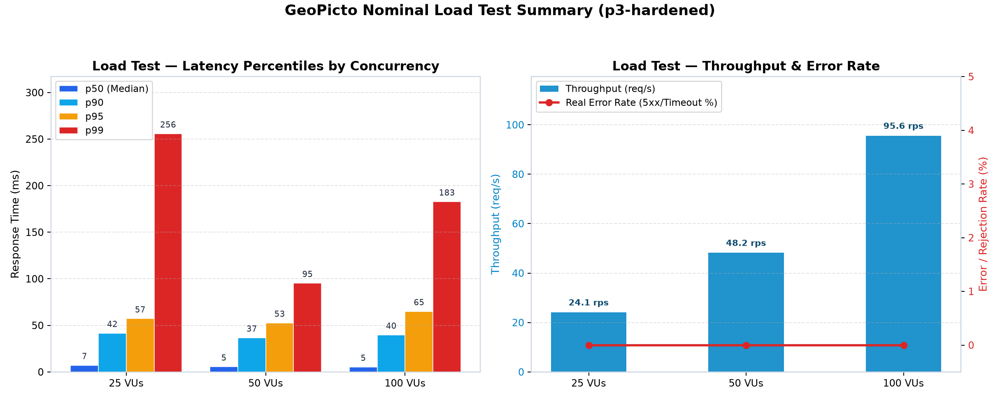
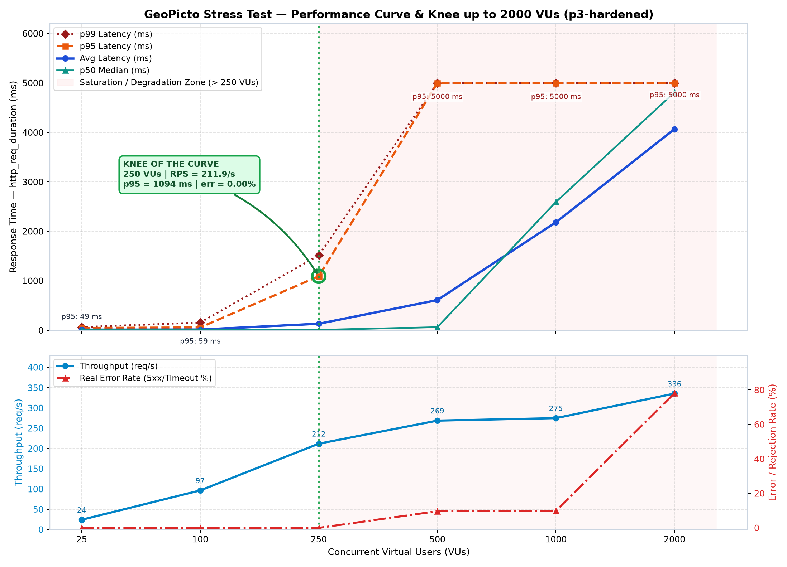
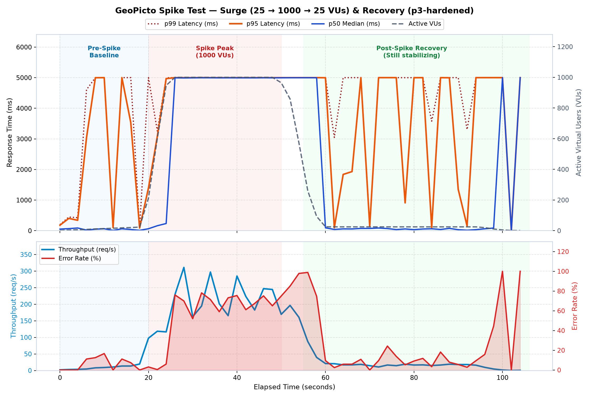
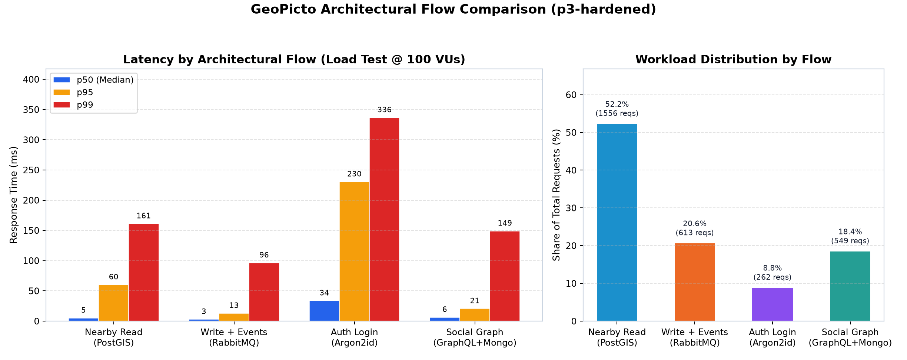
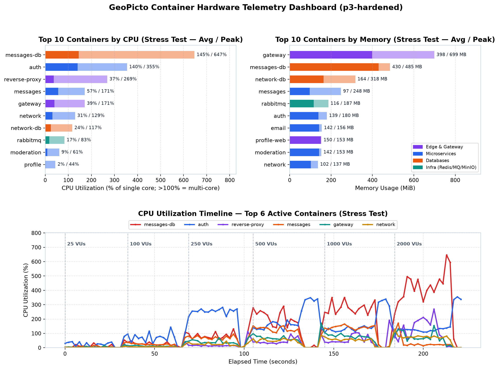

# Prototype 3 — Quality Attributes, Part 1 (Security & Performance)

**Course:** Software Architecture — 2026-II  
**University:** Universidad Nacional de Colombia  
**Team:** 2F  
**Software System:** GeoPicto  

---

## 1. Team

**Team Name:** `2F`

**Team Members:**

- Sergio Andres Hernández Salinas
- Juan Esteban Medina Cardenas
- Juan Pablo Barreto Hernández
- Juan Esteban Santacruz Corredor
- Andres Felipe Ramirez Fajardo
- Cristian Felipe Ramirez Montenegro
- Diego Fernando Mellizo Pedraza
- Julian Santiago Becerra Pulido

---

## 2. Software System

### 2.1 Name

**GeoPicto**

### 2.2 Logo


### 2.3 Description

**GeoPicto** is a distributed geospatial contextual social network in which users publish, discover, and rate short messages anchored to real-world geographic coordinates. By combining social networking features (user profiles, friend graphs, real-time notifications, likes/dislikes, and explorer reputation levels) with spatial proximity queries, GeoPicto enables location-aware interaction with nearby community content.

In **Prototype 2**, the team achieved full functional completeness across two presentation applications (`geopicto-mobile` and `geopicto-web`), an API Gateway (`api-gateway`), nine polyglot backend microservices, an asynchronous event broker (`rabbitmq`), and dedicated data stores. However, Prototype 2 exposed multiple edge ports over unencrypted HTTP/WS, operated over a single flat Docker network, lacked API rate limiting, and allowed revoked JWT access tokens to remain valid until expiration.

In **Prototype 3**, the architecture is redesigned around non-functional quality attributes — specifically **Security** (addressing five formal security scenarios via architectural tactics and patterns) and **Performance and Scalability** (establishing reproducible load, stress, and spike testing with resource telemetry and bottleneck analysis).

---

## 3. Architectural Structures

### 3.1 Component-and-Connector (C&C) Structure

#### 3.1.1 C&C View


#### 3.1.2 Diagram Conventions

| Visual Element | Meaning |
| --- | --- |
| Orange component box (`reverse-proxy`) | Perimeter reverse proxy executing TLS termination, HTTP hardening, and unified edge routing. |
| Red component box | Presentation component serving the SPA or SSR web interface. |
| Purple component box | Communication and orchestration component (`api-gateway` for synchronous routing/security; `broker` for asynchronous domain events). |
| Blue component box | Runtime business-logic microservice with its language, framework, and core responsibility. |
| Green cylinder | Persistent data store (relational PostgreSQL/PostGIS, MongoDB, or MinIO S3 object storage). |
| Orange cylinder | In-memory data store (`redis`) shared across real-time pub/sub, rate limiting, and token revocation. |
| Gray component box | External client (`User Browser / Mobile App`) or local development support component (`mailpit`). |
| Purple solid arrow (`HTTPS`) | External TLS 1.2/1.3-encrypted REST and GraphQL traffic (`HTTPS :443`) from client devices to `reverse-proxy`. |
| Teal solid arrow (`Internal HTTP`) | Internal unencrypted HTTP carrying combined REST and GraphQL traffic (`reverse-proxy → api-gateway` and `geopicto-web → api-gateway` over `edge_net`). |
| Red solid arrow (`REST`) | Internal HTTP REST connector (`api-gateway` → REST services and `reverse-proxy` → presentation servers). |
| Blue solid arrow (`GraphQL`) | Internal HTTP GraphQL connector (`api-gateway → network`). |
| Green solid arrow (`WSS / WS`) | TLS-encrypted WebSocket (`WSS :443`) externally and proxied internal WebSocket (`WS`) through `api-gateway` to `realtime`. |
| Orange dashed arrow (`Redis Security`) | RESP connector over `redis_net` used by `api-gateway` (Token Bucket rate limiting and JWT blacklist checks) and `auth` (writing revoked session IDs `sid` on session termination). |
| Black dashed line (`Broker connector`) | Asynchronous AMQP publish/subscribe interaction through RabbitMQ. |
| Black solid line (`Database / Storage`) | Exclusive persistence access from a service to its own data store. |

#### 3.1.3 Architectural Elements and Relations

The C&C view separates runtime interactions into three communication planes: **encrypted perimeter entry** through `reverse-proxy`, **synchronous internal routing** through `api-gateway`, and **asynchronous event choreography** through `broker` (RabbitMQ). Business-logic services never invoke one another synchronously to fulfill a domain workflow; cross-service reactions are decoupled through versioned domain events.

##### Edge, Presentation, and Communication Components

| Component (C&C / Container) | Type | Technology | Responsibility | Interfaces |
| --- | --- | --- | --- | --- |
| `reverse-proxy` | Perimeter edge / reverse proxy | Nginx (Alpine), TLS 1.2/1.3 | Single public entry point. Performs TLS termination (`:443`), enforces `301` HTTP-to-HTTPS redirection (`:80`), applies HSTS and HTTP security headers, enforces a `6 MB` payload cap, and routes traffic to `geopicto-mobile`, `geopicto-web`, and `api-gateway`. | Public HTTPS/WSS on `:443` and HTTP redirect on `:80`; internal HTTP/WS toward edge services. |
| `geopicto-mobile` (`frontend`) | Presentation (SPA / Mobile) | TypeScript, Expo 57, React Native / React Native Web, MapLibre, Nginx | Mobile and web map application for exploring nearby messages, publishing geolocated notes, managing friends, voting, and receiving live notifications. Served internally as a static SPA behind `reverse-proxy`. | Internal HTTP `:80`; consumes `https://` REST, GraphQL, and `wss://` WebSocket via `reverse-proxy`. |
| `geopicto-web` (`profile-web`) | Presentation (Web SSR / BFF) | TypeScript, Next.js 16.4, React 19.3, Server Components & Server Actions | Server-side rendered account portal for profile management, avatars, own messages, reputation, and friend network. Stores JWTs in `httpOnly`, `Secure` cookies (`COOKIE_SECURE=true`) and communicates internally with `api-gateway`. | Internal HTTP `:3000`; HTML/RSC returned through `reverse-proxy`; internal REST/GraphQL to `api-gateway`. |
| `api-gateway` (`gateway`) | Synchronous communication & security orchestration | Java 21, Spring Boot 4, Spring Cloud Gateway WebFlux, `jjwt`, Reactive Redis | Internal API entry point. Enforces per-route Token Bucket rate limiting (via Redis), validates HS256 JWTs, rejects revoked tokens against the Redis blacklist, strips forged `X-User-ID` and external `X-Internal-Token` headers, injects trusted `X-User-ID`, enforces CORS, and proxies WebSocket handshakes. | Internal HTTP/WS on `:8080`; RESP to `redis`; internal HTTP/WS to logic services; `/actuator/health`. |
| `broker` (`rabbitmq`) | Asynchronous communication & choreography | RabbitMQ 4, `topic` exchange `geopicto.events` | Transports versioned domain events between producers and consumers, decoupling moderation, email delivery, ratings projections, reputation scoring, and real-time notifications. | Internal AMQP on `:5672`. |

##### Logic Components

| Component (C&C / Container) | Type | Technology | Responsibility | Interfaces and Data |
| --- | --- | --- | --- | --- |
| `auth` | Logic | Python 3.13, FastAPI, SQLAlchemy, Argon2id, PyJWT, Redis client | User registration, login, HS256 JWT access token issuance, rotating refresh tokens with reuse detection, account lockout on failed attempts, password changes, and immediate session revocation (`auth:revoked:sid:<sid>` written to Redis blacklist with remaining-lifetime TTL on logout, `logout-all`, session revocation, password change, or token-theft detection). | REST under `/auth/*`; publishes `user.registered.v1`; owns `auth-db`; writes revocation keys to `redis`. |
| `messages` | Logic | Go 1.27, `net/http`, `pgx`, PostGIS | Publishes geolocated notes, retrieves messages by ID, executes spatial proximity queries (`ST_DWithin`), deletes own messages, and applies moderation verdicts. | REST under `/messages/*`; publishes `message.submitted.v1`, `message.published.v1`, `message.deleted.v1`; consumes `moderation.completed.v1`, `moderation.failed.v1`; owns `messages-db`. |
| `network` | Logic | Python 3.13, FastAPI, Strawberry GraphQL, MongoDB driver | Manages friend requests (send, accept, reject, cancel), unfriend operations, and unified social graph queries. | GraphQL under `/graphql`; publishes `activity.created.v1`, `notification.requested.v1`; owns `network-db`. |
| `profile` | Logic | Python 3.13, FastAPI, SQLAlchemy, MinIO S3 client, Pillow | Manages display name, biography, accent color, and WebP avatars (processed via Pillow). Supports batch profile resolution and user search. | REST under `/profiles/*`; consumes `user.registered.v1` (plus forward-compatible bindings for `user.updated.v1`, `user.deleted.v1`); publishes `profile.updated.v1`; owns `profile-db` and private `minio` bucket `geopicto-avatars`. |
| `rating` | Logic | Go 1.27, `net/http`, `pgx` | Registers likes and dislikes, maintains per-message vote counters, and keeps an event-driven projection of published messages. | REST under `/ratings/*`; consumes `message.published.v1`, `message.deleted.v1`; publishes `rating.changed.v1`; owns `rating-db`. |
| `reputation` | Logic & async processor | Go 1.27, `net/http`, `pgx` | Computes bounded explorer score (`0–1000`), level progression, immutable idempotent movement ledger, and leaderboard. | REST under `/reputation/*`; consumes `rating.changed.v1`, `moderation.completed.v1`; publishes `reputation.changed.v1`; owns `reputation-db`. |
| `realtime` (`socket-gateway`) | Logic & async processor | Elixir 1.18, OTP, Bandit, Plug, WebSockAdapter, Redix, AMQP | Issues single-use ephemeral WebSocket tickets, maintains live WebSocket connections, manages topic subscriptions/presence, and fans out domain events via Redis Pub/Sub. | `POST /tickets`, `GET /ws`, `/health`, `/metrics`; consumes `socket.events.q`; uses `redis`. |
| `moderation` | Logic & async processor | Python 3.13, FastAPI, deterministic YAML rule engine | Evaluates newly submitted messages asynchronously using deterministic YAML rules, assigns `ALLOW`, `WARN`, or `BLOCK` verdicts, persists audit logs, and publishes outcomes via RabbitMQ. | Consumes `message.submitted.v1`; publishes `moderation.completed.v1`, `moderation.failed.v1`; internal `/internal/*` API; owns `moderation-db`. |
| `email` | Logic & async processor | Python 3.13, FastAPI, Jinja2, `aiosmtplib` | Sends transactional and welcome emails asynchronously with registered templates, idempotency tracking, TTL retry queues, and a dead-letter queue (DLQ). | Consumes `user.registered.v1`, `email.requested.v1`; publishes `email.sent.v1`, `email.failed.v1`; internal `/internal/emails`; owns `email-db`; SMTP to `mailpit`. |

##### Data and Support Components

| Component | Type | Technology | Responsibility | Exclusive Owner / Users |
| --- | --- | --- | --- | --- |
| `auth-db` | Relational data | PostgreSQL 18 | Users, Argon2id credentials, sessions, and hashed refresh tokens. | `auth` only. |
| `messages-db` | Relational + geospatial data | PostgreSQL 18 + PostGIS 3.6 | Messages, moderation status, versioning, and `GEOGRAPHY(Point, 4326)` with GiST index. | `messages` only. |
| `network-db` | NoSQL document data | MongoDB 8 | `friendships` collection storing user pairs, request state, requester, and timestamps. | `network` only. |
| `profile-db` | Relational data | PostgreSQL 18 | Public profile attributes, display name, bio, color, and avatar object key. | `profile` only. |
| `rating-db` | Relational data | PostgreSQL 18 | Individual votes, aggregated per-message counts, and published message projection. | `rating` only. |
| `reputation-db` | Relational data | PostgreSQL 18 | Aggregated user scores/levels and immutable idempotent reputation ledger. | `reputation` only. |
| `moderation-db` | Relational data | PostgreSQL 18 | Moderation verdicts, rule reasons, and audit trail. | `moderation` only. |
| `email-db` | Relational data | PostgreSQL 18 | Delivery log, state transitions, retry counters, and idempotency keys. | `email` only. |
| `minio` | Object storage | MinIO (S3-compatible) | Private bucket storing processed WebP user avatars. | `profile` only. |
| `redis` | In-memory store | Redis 7 | Ephemeral WebSocket tickets, presence, and Pub/Sub (DB 0); Token Bucket rate-limit counters and revoked JWT blacklist with TTL (DB 1). | `realtime`, `api-gateway`, and `auth`. |
| `mailpit` | Development support | Mailpit | Local SMTP sink (`:1025`) and internal inspection UI (`:8025`) for prototype testing. | `email` only. |

##### Connectors

| Connector | Source → Target | Style / Protocol | Detail |
| --- | --- | --- | --- |
| External Edge Access | `User Browser / Mobile App` → `reverse-proxy` | HTTPS / WSS (TLS 1.2/1.3) | All external traffic enters exclusively over `:443` (with `:80` enforcing `301` redirect to HTTPS). |
| SPA & SSR Proxying | `reverse-proxy` → `geopicto-mobile` / `geopicto-web` | HTTP | Routes `/*` to `frontend:80` and `/account/*`, `/login`, `/_next/*`, `/icon.svg`, `/logo.png` to `profile-web:3000` (plus local `/healthz` probe on Nginx). |
| API & WS Proxying | `reverse-proxy` → `api-gateway` | HTTP / WS (`Upgrade`) | Routes `/api/*` and `/api/ws` to `gateway:8080`, overwriting `X-Real-IP`/`X-Forwarded-For`/`X-Forwarded-Proto` and stripping `X-Internal-Token`. |
| SSR Backend Calls | `geopicto-web` → `api-gateway` | HTTP REST & GraphQL | Server-side calls from Next.js (`http://gateway:8080`); browser never exposes JWTs to client JS. |
| Synchronous Service Routes | `api-gateway` → `auth`, `messages`, `profile`, `rating`, `reputation` | HTTP REST | Rewrites `/api/<service>/**`, validates JWT + blacklist, applies Token Bucket rate limits, and injects trusted `X-User-ID`. |
| Social Graph Route | `api-gateway` → `network` | HTTP GraphQL | Rewrites `/api/network/graphql` to `/graphql`. |
| Real-Time Route | `api-gateway` → `realtime` | HTTP & WebSocket | `POST /api/socket/tickets` issues ephemeral ticket; `/api/ws` proxies the WebSocket upgrade handshake. |
| Security State Lookup | `api-gateway` → `redis` | RESP (Redis DB 1, `redis_net`) | Atomic Lua Token Bucket check and revoked session/token (`auth:revoked:sid:<sid>`, plus optional `jti`) blacklist verification. |
| Token Revocation Write | `auth` → `redis` | RESP (Redis DB 1, `redis_net`) | Publishes revoked `auth:revoked:sid:<sid>` key with TTL equal to remaining JWT lifetime upon logout, `logout-all`, session revocation, password change, or refresh-token reuse detection. |
| Persistence | Service → own data store | SQL / Mongo / S3 / RESP | Strict database-per-service ownership; zero cross-database queries or foreign keys. |
| Domain Events | Logic services ↔ `broker` | AMQP (`:5672`) | Shared event envelope (`eventId`, `eventType`, `version`, `occurredAt`, `producer`, `correlationId`, `causationId`, `payload`) on topic exchange `geopicto.events`. |
| Transactional Email | `email` → `mailpit` | SMTP (`:1025`) | Local SMTP relay inside `email_data_net (internal: true)`; switching to an authenticated external SMTP relay in production requires adding a controlled egress network alongside environment variables. |

##### Domain Events

| Producer | Event | Consumers and Effect |
| --- | --- | --- |
| `auth` | `user.registered.v1` | `profile` initializes the public profile; `email` sends the welcome email. |
| `messages` | `message.submitted.v1` | `moderation` evaluates message text against deterministic YAML rules. |
| `moderation` | `moderation.completed.v1` | `messages` applies `ALLOW`/`WARN`/`BLOCK`; `reputation` adjusts score; `realtime` notifies author. |
| `moderation` | `moderation.failed.v1` | `messages` applies the configured failure policy (`FAIL_OPEN` / `FAIL_CLOSED`). |
| `messages` | `message.published.v1` | `rating` updates its published-message projection; `realtime` broadcasts to global and author topics. |
| `messages` | `message.deleted.v1` | `rating` marks the message deleted; `realtime` broadcasts removal. |
| `rating` | `rating.changed.v1` | `reputation` updates explorer score and ledger; `realtime` pushes vote update. |
| `reputation` | `reputation.changed.v1` | `realtime` notifies user of new score/level. |
| `network` | `activity.created.v1` / `notification.requested.v1` | `realtime` delivers friendship notifications to target users. |
| `profile` | `profile.updated.v1` | `realtime` propagates profile updates. |
| `email` | `email.sent.v1` / `email.failed.v1` | Delivery audit and observability events. |

##### Architectural Constraints

1. **Single Perimeter Entry:** Only `reverse-proxy` exposes ports (`:80` redirect and `:443` HTTPS/WSS) to the external host. Neither `api-gateway`, presentation servers, logic services, nor data stores are directly reachable externally.
2. **Defense-in-Depth Identity:** `api-gateway` validates HS256 JWTs, rejects revoked sessions against the Redis blacklist, strips client-supplied `X-User-ID` and `X-Internal-Token` headers (also stripped at `reverse-proxy`), and injects trusted identity. Additionally, `messages`, `network`, and `profile` independently verify JWT signature, `iss`, and `exp` locally (while Redis blacklist enforcement stays centralized at `api-gateway` and PostgreSQL session validation runs in `auth`).
3. **Strict Data Ownership:** Every persistent store has a single owning microservice; cross-domain references use UUIDs only.
4. **No Direct Synchronous Service-to-Service Calls:** Logic services communicate exclusively via RabbitMQ; `moderation` and `email` have no public routes through `api-gateway`.
5. **Graceful Degradation:** Rate limiting operates in `fail-open` mode (`500ms` timeout) if Redis is temporarily unreachable to preserve service availability, while `moderation` evaluates deterministically via local YAML rules without external third-party dependencies.

#### 3.1.4 Architectural Styles and Patterns Used

1. **Distributed Client-Server:** Mobile/browser clients interact with isolated containerized servers exclusively over network protocols (HTTPS, WSS, HTTP, AMQP, RESP, SQL).
2. **Microservices with Database-per-Service:** Nine bounded-context services built, scaled, and persisted independently using polyglot engines (PostgreSQL, PostGIS, MongoDB, MinIO, Redis).
3. **Reverse Proxy & Secure Channel (Perimeter Security):** `reverse-proxy` centralizes TLS termination, HTTP hardening headers, payload limits, and single-port ingress.
4. **API Gateway & Gateway Offloading:** `api-gateway` offloads JWT validation, distributed token blacklist checking, Token Bucket rate limiting, header sanitization, and CORS from downstream services.
5. **Event-Driven Architecture (Choreography) & Asynchronous Workers:** RabbitMQ decouples producers from `moderation`, `email`, `reputation`, `rating`, and `realtime` with idempotency, manual ACKs, TTL retries, and DLQs.
6. **SSR & Backend for Frontend (BFF):** `geopicto-web` fetches gateway resources server-side via Next.js Server Components/Actions while keeping tokens inside `httpOnly; Secure` cookies.
7. **Multi-Protocol APIs (REST, GraphQL, WebSocket):** REST for resource CRUD, GraphQL in `network` for composite social queries, and WebSocket in `realtime` for low-latency push updates.
8. **Event-Driven Read Projections:** `rating` maintains a local projection of published messages and `reputation` maintains an append-only ledger plus materialized summary without querying foreign databases.

---

### 3.2 Deployment Structure

#### 3.2.1 Deployment View


#### 3.2.2 Architectural Elements and Relations

Following the *Views and Beyond* allocation model, the Deployment View models the external `<<device>> Client Device` communicating across an untrusted network exclusively with host ports `:80` (redirect) and `:443` (HTTPS/WSS), and maps each runtime software element from the C&C view (`Deployed_in` green dashed arrows) onto its concrete **Execution Environment** inside one of **25 Docker containers** hosted on a single physical/virtual `<<device>> Host Server Machine` running Docker Engine and Docker Compose v2.

| Element | Description |
| --- | --- |
| `<<device>> Client Device` | End-user desktop browser or mobile OS executing the GeoPicto client (`geopicto-mobile` SPA / Expo app or browser rendering `geopicto-web`). Communicates over an untrusted network exclusively with exposed host ports `:80` (`301` redirect) and `:443` (`HTTPS/WSS`, TLS 1.2/1.3), making the Scenario S1 encryption boundary explicit. |
| `<<device>> Host Server Machine` | Physical or virtual host executing Docker Engine and Docker Compose v2. Only ports `:80` and `:443` are exposed at the host boundary. |
| Exposed Perimeter Container (1) | `reverse-proxy` (Nginx Alpine), publishing `:80` (redirect) and `:443` (HTTPS/WSS) to the host and forwarding internally over `edge_net`. |
| Internal Edge & Presentation Containers (3) | `frontend` (`:80`), `profile-web` (`:3000`), and `gateway` (`:8080`). No host ports published. |
| Internal Logic Containers (9) | `auth`, `messages`, `network`, `profile`, `rating`, `reputation`, `socket-gateway`, `moderation`, and `email` (all listening internally on `:8080`). |
| Internal Data, Broker & Support Containers (12) | `rabbitmq` (`:5672`), `redis` (`:6379`), `minio` (`:9000`), `mailpit` (`:1025`), `auth-db` (`:5432`), `messages-db` (`:5432`), `network-db` (`:27017`), `profile-db` (`:5432`), `rating-db` (`:5432`), `reputation-db` (`:5432`), `moderation-db` (`:5432`), and `email-db` (`:5432`). |
| Named Persistent Volumes (9) | `auth_data`, `messages_data`, `network_data`, `profile_data`, `profile_avatars` (mounted on MinIO), `rating_data`, `reputation_data`, `moderation_data`, and `email_data`. |
| Segmented Docker Networks (12) | Replaces Prototype 2's flat bridge network with `edge_net` (a non-internal perimeter bridge network supporting host-published ingress on `reverse-proxy`) and 11 `internal: true` isolated networks (`gateway_net`, `broker_net`, `redis_net`, and 8 dedicated `*_db_net` / `*_data_net` networks). |
| Healthchecks & Restart Policy | Every container defines native healthchecks (`HTTP`, `pg_isready`, `redis-cli`, `rabbitmq-diagnostics`, `mongosh`), ordered startup via `depends_on: condition: service_healthy`, and `restart: unless-stopped`. |

##### Published Host Ports (Prototype 3 vs. Prototype 2)

| Host Port | Container & Internal Port | Protocol / Purpose | Change from Prototype 2 |
| --- | --- | --- | --- |
| `80` | `reverse-proxy:80` | HTTP → `301` redirect to `https://` | **New** (enforces Secure Channel). |
| `443` | `reverse-proxy:443` | HTTPS & WSS (TLS 1.2/1.3 termination) | **New** (single application entry point). |
| ~~`8080`, `8081`, `8082`, `8025`~~ | `gateway`, `frontend`, `profile-web`, `mailpit` | **Closed on host** (internal Docker DNS only) | **Removed** from host exposure (*Limit Exposure*). |

##### Network Segmentation Topology (Connectivity Matrix)

| Docker Network | `internal: true` | Member Containers | Security Isolation Enforced |
| --- | --- | --- | --- |
| `edge_net` | No (perimeter bridge) | `reverse-proxy`, `frontend`, `profile-web`, `gateway` | Perimeter bridge network (external ingress occurs solely via host-published ports `:80`/`:443` on `reverse-proxy`); zero reachability to logic services, broker, Redis, or databases. |
| `gateway_net` | **Yes** | `gateway`, `auth`, `messages`, `network`, `profile`, `rating`, `reputation`, `socket-gateway` | Restricts synchronous routing strictly to HTTP/WS services; excludes `moderation` and `email`. |
| `broker_net` | **Yes** | `rabbitmq` and all 9 logic services | Dedicated AMQP event bus; excludes `gateway` and `redis` (preventing `gateway` from reaching `moderation`, `email`, or `rabbitmq`); no internet egress. |
| `redis_net` | **Yes** | `redis`, `gateway`, `auth`, `socket-gateway` | Isolates Redis strictly to its 3 authorized clients (rate limiting, JWT blacklist, and real-time pub/sub); blocks the other 7 microservices from accessing Redis. |
| `auth_db_net` | **Yes** | `auth`, `auth-db` | Only `auth` can reach `auth-db:5432`. |
| `messages_db_net` | **Yes** | `messages`, `messages-db` | Only `messages` can reach `messages-db:5432`. |
| `network_db_net` | **Yes** | `network`, `network-db` | Only `network` can reach `network-db:27017`. |
| `profile_data_net` | **Yes** | `profile`, `profile-db`, `minio` | Only `profile` can reach `profile-db:5432` and `minio:9000`. |
| `rating_db_net` | **Yes** | `rating`, `rating-db` | Only `rating` can reach `rating-db:5432`. |
| `reputation_db_net` | **Yes** | `reputation`, `reputation-db` | Only `reputation` can reach `reputation-db:5432`. |
| `moderation_db_net` | **Yes** | `moderation`, `moderation-db` | Only `moderation` can reach `moderation-db:5432`. |
| `email_data_net` | **Yes** | `email`, `email-db`, `mailpit` | Only `email` can reach `email-db:5432` and `mailpit:1025`. |

#### 3.2.3 Deployment Patterns Used

1. **One Container per Component:** Independent build, lifecycle, healthcheck, and scaling boundary for all 25 components.
2. **Perimeter Reverse Proxy with Single-Host Ingress:** Eliminates direct port exposure of application servers and centralizes TLS termination.
3. **Micro-Segmented Internal Networks (`internal: true`):** Prevents lateral movement both vertically (edge cannot reach data stores; `gateway` cannot reach `moderation`, `email`, `rabbitmq`, or any database) and horizontally (one compromised service cannot reach another service's database, and non-Redis services cannot access `redis`).
4. **Compose DNS Service Discovery:** Stable internal hostnames (`gateway`, `auth-db`, `rabbitmq`, `redis`) decoupled from IP addresses.
5. **Multi-Stage & Minimal Container Builds:** Compiled and frontend services (`gateway`, `messages`, `rating`, `realtime`, `frontend`, `profile-web`) use multi-stage Docker builds, while Python services run on minimal `python:3.13-slim` images to reduce runtime attack surface.
6. **Externalized Environment Configuration:** Secrets (`JWT_SECRET`, `INTERNAL_TOKEN`), TLS certificates, rate-limit thresholds, CORS/WS origins, and database credentials are injected via `.env` / environment variables.
7. **Persistent Named Volumes & Health-Ordered Startup:** Ensures durability across container recreations and prevents startup race conditions.

---

### 3.3 Layered Structure

#### 3.3.1 Layered View


#### 3.3.2 Description of Architectural Elements and Relations

The Layered View organizes GeoPicto into **five logical tiers (`T1`–`T5`)**, documenting both the inter-tier usage rules (`Allowed to use` for closed layers vs. `Allowed to use below` for controlled downward relaxation) and the **internal micro-architecture** implemented inside each tier's components. Note that `T2` models the server-side presentation delivery components (`frontend` static SPA server and `profile-web` Next.js SSR server), while all external client traffic enters exclusively through `T1` (`reverse-proxy`).

| Tier | Layer Name | Contained Components & Internal Sub-Architectures | Responsibility |
| --- | --- | --- | --- |
| **`T1`** | **Edge / Reverse Proxy** | **Reverse Proxy (`reverse-proxy` — Nginx):** `TLS Termination (HTTPS/WSS & HSTS)` → `HTTP Hardening (Headers & 6M Limit)` → `Reverse Routing (/, /account, /api, /api/ws)`. | Perimeter entry, channel encryption, security headers, and unified routing toward presentation (`T2`) and API gateway (`T3`). |
| **`T2`** | **Presentation** | **Context / Hooks (`geopicto-mobile`):** `Screens & Components` → `Context & State Hooks` → `HTTPS/WSS API Clients` → `UI/Map Store`.<br>**SSR / App Router (`geopicto-web`):** `Server Components` → `Server Actions` → `BFF Client & Secure Cookies` + `Client Hydration UI`. | Presentation delivery (static SPA bundle and SSR rendering), user interaction, map visualization, and BFF session handling. |
| **`T3`** | **Connection** | **Layered / Security Pipeline (`api-gateway`):** `Header Sanitizer (Strip Forged Headers)` → `Auth & Blacklist (JWT + Redis Check)` → `Rate Limiter (Token Bucket / 429)` → `Routing & Proxy Infrastructure (RouteLocator, CORS & WS Handshake)`. *(Public routes such as `/api/auth/login` and `/api/messages/nearby` skip `Auth & Blacklist` and evaluate IP-scoped `Rate Limiter` directly; JWT-protected write routes execute `Auth & Blacklist` before user-scoped `Rate Limiter`.)* | Centralized API security enforcement, header sanitization, throttling, identity propagation, and synchronous request routing. |
| **`T4`** | **Logic** | **Layered REST (`auth`, `messages`, `profile`, `rating`, `reputation`):** `Presentation (handler/schema)` → `Application (service & revocation)` → `Domain (domain entities)` & `Infrastructure (repository, messaging, storage, redis blacklist)` (with `Infrastructure → Domain` mapping; `Domain` has zero outbound dependencies).<br>**Layered GraphQL (`network`):** `Presentation (gql/Strawberry)` → `Application (services)` → `Domain (models)` & `Infrastructure (repositories, messaging)` (with `Infrastructure → Domain`).<br>**Layered Event-Driven (`moderation`, `email`, `realtime`):** `Entrypoint (AMQP consumers, ws_socket, router)` → `Core (services, event_router, domain)` → `Support & Outbound (templates, SMTP, Redis, AMQP)`. | Core domain business rules, spatial queries, social graph operations, scoring, moderation, and asynchronous event processing. |
| **`T5`** | **Data & Messaging** | `auth-db`, `messages-db`, `network-db`, `profile-db`, `rating-db`, `reputation-db`, `moderation-db`, `email-db`, `minio`, `broker (rabbitmq)`, `mailpit`, and **`redis`** *(WS Pub/Sub, Rate Limit Buckets & Revoked JWT Blacklist)*. | Durable polyglot persistence, object storage, asynchronous message brokering, and low-latency shared security/real-time state. |

##### Inter-Layer Usage Rules

| Relation | Rule Type | Justification and Architectural Constraint |
| --- | --- | --- |
| `T1` → `T2` *(and `T1` → `T3`)* | **`Allowed to use below`** (Controlled downward bypass to `T3`) | `reverse-proxy` forwards UI navigation routes (`/*`, `/account/*`, `/login`) to `T2` presentation servers **and** proxies API/WebSocket paths (`/api/*`, `/api/ws`) directly to `T3` (`api-gateway`) via the explicit orange dashed dependency, without bypassing into business logic (`T4`) or data stores (`T5`). |
| `T2` → `T3` | **`Allowed to use`** (Closed) | Presentation applications (`geopicto-mobile`, `geopicto-web`) only invoke backend capabilities through `api-gateway` (server-side directly on `edge_net` for `geopicto-web`, or externally via `reverse-proxy` for client-side SPA calls); they never contact microservices (`T4`) or data stores (`T5`) directly. |
| `T3` → `T4` *(and `T3` → `T5`)* | **`Allowed to use below`** (Controlled downward bypass to `T5`) | `api-gateway` primarily routes requests to `T4` logic services, **and** is explicitly permitted to access `T5` (`redis`) via the red dashed dependency for low-latency **Rate Limiting** and **JWT Blacklist** enforcement before traffic ever reaches `T4`. |
| `T4` → `T5` | **`Allowed to use`** (Closed) | Each microservice in `T4` accesses only its own persistent store in `T5`, plus `rabbitmq` (for domain events) and `redis` (for `realtime` fanout and `auth` logout revocation). Placing `broker (rabbitmq)` in `T5` keeps all dependencies strictly downward. |

#### 3.3.3 Architectural Patterns Used

1. **Relaxed Layered Architecture (Closed Tiers with Controlled Bypasses in `T1` and `T3`):** Preserves strictly acyclic downward dependencies (`T2→T3`, `T4→T5`) while explicitly documenting two controlled *Allowed to use below* exceptions: (a) `T1` (`reverse-proxy`) → `T3` (`api-gateway`) so `/api/*` and `/api/ws` traffic reaches the gateway directly after TLS termination without passing through presentation servers (`T2`), and (b) `T3` (`api-gateway`) → `T5` (`redis`) so abusive or revoked requests are rejected at the gateway with sub-millisecond Redis lookups instead of overloading `T4` services.
2. **Pipes-and-Filters Security Pipeline (`T1` & `T3`):** Both `reverse-proxy` and `api-gateway` process each incoming request through ordered filters (TLS Termination → HTTP Hardening → Reverse Routing → Header Sanitization → JWT & Blacklist / Rate Limiting → Proxy Routing).
3. **Internal Layered & Event-Driven Micro-Architectures (`T4`):** Each microservice cleanly isolates transport adapters (`handler`/`gql`/consumers), application use cases (`service`), pure domain models (`domain`, with no dependency on infrastructure), and outbound adapters (`repository`/`messaging`/`storage`).
4. **Shared Infrastructure Layer for Asynchronous Messaging (`T5`):** Hosting RabbitMQ and Redis in `T5` eliminates horizontal dependencies between `T4` services and preserves strictly acyclic downward dependencies.

---

### 3.4 Decomposition Structure

#### 3.4.1 Decomposition View


#### 3.4.2 Description of Architectural Elements and Relations

Following strict functional decomposition (*Views and Beyond* `Is part of` relation), the Decomposition View models **exclusively the user-facing functional requirements** of **GeoPicto** mapped to the **six user-facing business modules** present in the C&C view (`Auth`, `Messages`, `Network`, `Profile`, `Rating`, and `Reputation`). Non-functional mechanisms (TLS, reverse proxy, rate limiting, token blacklists, network segmentation) and internal background infrastructure (`rabbitmq`, `moderation`, `email`, `realtime`) are intentionally excluded from this view and modeled in the C&C, Layered, and Deployment structures.

| Functional Module | Relation | User-Facing Functionalities (`Is part of`) |
| --- | --- | --- |
| **`Auth`** | `Is part of` `GeoPicto` | • Register a new user account.<br>• Log in with username or email.<br>• Log out of the platform.<br>• Change account password. |
| **`Messages`** | `Is part of` `GeoPicto` | • Explore nearby messages on the map.<br>• Filter messages by proximity radius.<br>• Publish a message at the user's location.<br>• View details and delete own messages. |
| **`Network`** | `Is part of` `GeoPicto` | • Send a friend request to another user.<br>• Accept, reject, or cancel friend requests.<br>• View friends list and pending requests.<br>• Remove a user from the friends list. |
| **`Profile`** | `Is part of` `GeoPicto` | • View and edit display name, bio, and color.<br>• Upload and update profile avatar.<br>• Search other user profiles. |
| **`Rating`** | `Is part of` `GeoPicto` | • Like or dislike a message.<br>• Update or remove a rating.<br>• View message like and dislike counts. |
| **`Reputation`** | `Is part of` `GeoPicto` | • View explorer score and level progress.<br>• View earned or lost points history.<br>• View leaderboard ranking. |

---

## 4. Quality Attributes

### 4.1 Security

To satisfy the non-functional security requirements of Prototype 3, GeoPicto addresses **five distinct security scenarios** — three mandatory perimeter/infrastructure patterns (**Secure Channel**, **Reverse Proxy**, **Network Segmentation**) and two team-defined application-security patterns (**Rate Limiting / Throttling** and **Distributed Token Revocation / Session Blacklist**).

#### 4.1.1 Security Scenarios

Each scenario is formalized using the six-part Quality Attribute Scenario specification (*Bass, Clements & Kazman — Software Architecture in Practice*):

##### Scenario S1 — Confidentiality & Integrity in Transit (*Secure Channel Pattern*)

| Scenario Part | Specification |
| --- | --- |
| **Source of Stimulus** | External network attacker located on an untrusted public Wi-Fi or intermediate network hop (*Man-in-the-Middle / Eavesdropper*). |
| **Stimulus** | Attempts to intercept, sniff, or tamper with login credentials, JWT access tokens, session cookies, real-time WebSocket frames, or user GPS coordinates traveling between the client and the server. |
| **Artifact** | External communication channels between client devices (browser / mobile app) and GeoPicto's ingress (`reverse-proxy`), plus SSR session cookies (`geopicto-web`). |
| **Environment** | Normal production-like operation over public/untrusted networks. |
| **Response** | All external HTTP and WebSocket connections are encrypted using TLS 1.2/1.3 (`https://` and `wss://`); plain HTTP requests to `:80` are forcefully redirected (`301 Moved Permanently`) to `:443`; HSTS (`Strict-Transport-Security`) prevents protocol downgrade; SSR cookies carry `HttpOnly` and `Secure` flags. |
| **Response Measure** | `100 %` of external application traffic uses TLS 1.2 or 1.3; `0` credentials, tokens, or payloads transmitted in plaintext; `100 %` of HTTP `:80` requests return `301` to `https://` and `100 %` of HTTPS `:443` responses carry `Strict-Transport-Security` (RFC 6797 §7.2). |

##### Scenario S2 — Perimeter Exposure Reduction (*Reverse Proxy Pattern*)

| Scenario Part | Specification |
| --- | --- |
| **Source of Stimulus** | External unauthenticated user or automated port scanner probing the host machine. |
| **Stimulus** | Attempts to directly access internal application servers (`frontend:8081`, `profile-web:8082`, `gateway:8080`), fingerprint backend server versions, send oversized payloads (`> 6 MB`), or exploit clickjacking/MIME-sniffing headers. |
| **Artifact** | Host network boundary, `reverse-proxy`, presentation containers (`frontend`, `profile-web`), and `api-gateway`. |
| **Environment** | Normal operation with all 25 Docker containers running. |
| **Response** | Direct host access to `8080`, `8081`, `8082`, and `8025` is refused because those ports are not published; all requests pass exclusively through `reverse-proxy` (`:443`), which hides server banners (`server_tokens off`), enforces `client_max_body_size 6M`, and injects security headers (`X-Frame-Options`, `X-Content-Type-Options`, `Referrer-Policy`). |
| **Response Measure** | Only ports `80` and `443` respond on the host (`0` direct application/gateway ports reachable); `100 %` of responses omit Nginx version banners and include hardening headers; payloads exceeding `6 MB` are rejected at the edge with `413 Payload Too Large`. |

##### Scenario S3 — Lateral Movement Containment (*Network Segmentation Pattern*)

| Scenario Part | Specification |
| --- | --- |
| **Source of Stimulus** | Attacker who has gained code execution inside a compromised perimeter or business container (e.g., `frontend`, `gateway`, or `rating`). |
| **Stimulus** | Attempts to open direct TCP connections to sensitive databases (`auth-db:5432`, `messages-db:5432`, `network-db:27017`), private object storage (`minio:9000`), Redis (`redis:6379` from non-authorized services), or non-routed internal workers/broker (`moderation`, `email`, `rabbitmq` from `gateway`). |
| **Artifact** | Docker virtual network topology, internal microservices, and all 12 data/messaging containers. |
| **Environment** | Post-compromise / breach-containment scenario during normal system operation. |
| **Response** | Network isolation via 11 `internal: true` Docker networks drops unauthorized DNS resolution and TCP connections: `edge_net` cannot reach any database, Redis, RabbitMQ, or logic service; `gateway_net` excludes `moderation` and `email` and cannot reach any database; `broker_net` connects only `rabbitmq` and the 9 logic services (excluding `gateway` and `redis`); `redis_net` restricts `redis` strictly to `gateway`, `auth`, and `socket-gateway`; and each `*_db_net` / `*_data_net` allows connectivity solely between the single owning service and its data store(s). |
| **Response Measure** | `100 %` of unauthorized cross-tier, cross-database, non-routed worker (`gateway ↛ moderation/email/rabbitmq`), and unauthorized Redis (`non-Redis services ↛ redis`) TCP connection probes fail (connection refused / DNS unresolvable / timeout) as verified by `scripts/test-network-segmentation.sh`, while `100 %` of authorized functional smoke tests succeed. |

##### Scenario S4 — Brute-Force & API DoS Mitigation (*Rate Limiting / Throttling Pattern*)

| Scenario Part | Specification |
| --- | --- |
| **Source of Stimulus** | Automated attacker or abusive client executing credential-stuffing/brute-force attacks or high-frequency API request bursts. |
| **Stimulus** | Sends a burst of login/registration requests (`POST /api/auth/login`, `/register`) to exhaust Argon2id CPU or guess passwords, or floods write/geospatial endpoints (`POST /api/messages`, `PUT, DELETE /api/ratings/messages/*`, `GET /api/messages/nearby`). |
| **Artifact** | `api-gateway` (`RateLimitGatewayFilterFactory`) and shared `redis` Token Bucket state (DB 1). |
| **Environment** | Normal or under-attack operation behind `reverse-proxy`. |
| **Response** | `api-gateway` atomically evaluates per-IP (`auth`, `nearby`) and per-user (`message-write`, `rating-write`) Token Bucket policies in Redis via a Lua script (`token_bucket.lua`). Excess requests are rejected at the gateway with `429 Too Many Requests`, `Retry-After`, and `X-RateLimit-*` headers without reaching downstream microservices or databases. |
| **Response Measure** | Once bucket capacity is exceeded (e.g., `> 10` requests on `/api/auth/login` per IP), `100 %` of excess requests receive HTTP `429` within `< 50 ms` end-to-end (`p95 < 25 ms` measured through `reverse-proxy` + Redis); `0` throttled requests reach backend microservices; legitimate users on distinct IPs/accounts remain unaffected. |

##### Scenario S5 — Immediate Post-Logout Token Invalidation (*Distributed Token Revocation / Session Blacklist Pattern*)

| Scenario Part | Specification |
| --- | --- |
| **Source of Stimulus** | Attacker in possession of a stolen or previously intercepted valid JWT access token (*Token Replay / Session Hijacking*). |
| **Stimulus** | Attempts to call a protected API endpoint using a user's JWT access token immediately after the legitimate user has terminated the session (`POST /api/auth/logout`, `logout-all`, `DELETE /api/auth/sessions/:id`, password change, or rotated refresh-token reuse detection) within the token's remaining 15-minute `exp` window. |
| **Artifact** | `auth` session revocation service, `redis` distributed revocation blacklist (DB 1 on `redis_net`), and `api-gateway` (`JwtAuthGatewayFilterFactory`). |
| **Environment** | Normal operation with stateless JWT authentication active. |
| **Response** | Upon session termination, `auth` records the revoked session key (`auth:revoked:sid:<sid>`) in `redis` with a TTL equal to the remaining access token lifetime (`exp - now`, bounded to 15 minutes). On every protected request, `api-gateway` verifies the HS256 signature and claims, checks the Redis blacklist (`sid`, and `jti` when present), and immediately rejects any revoked token with `401 Unauthorized`. |
| **Response Measure** | A logged-out JWT access token is rejected with HTTP `401 Unauthorized` in `< 1 second` after logout (`0 %` successful replay attempts during the remaining 15-minute expiration window), and revocation keys automatically expire from Redis upon token expiration. |

---

#### 4.1.2 Applied Architectural Tactics

Using the canonical security tactics taxonomy of *Bass, Clements & Kazman*, the table below maps each security scenario across **Resist Attacks**, **Detect Attacks**, and **React to Attacks** to its concrete realization in GeoPicto:

| Scenario | Tactic Category | Canonical Tactic (*Bass et al.*) | Concrete Realization in GeoPicto |
| --- | --- | --- | --- |
| **S1** | Resist Attacks | **Encrypt Data** *(Data in Transit)* | TLS 1.2/1.3 termination in `reverse-proxy` (HTTPS/WSS), HSTS header, forced HTTP→HTTPS `301` redirect, `COOKIE_SECURE=true`. |
| **S2** | Resist Attacks | **Limit Exposure** | Single-point ingress via `reverse-proxy` (`:80`, `:443`); removal of host `ports:` from `frontend`, `profile-web`, `gateway`, and `mailpit`; `server_tokens off`, `proxy_hide_header X-Powered-By`, and HTTP hardening headers (`X-Frame-Options`, `X-Content-Type-Options`, `Referrer-Policy`). |
| **S2** | Resist Attacks | **Validate Input** | `client_max_body_size 6M` payload cap at Nginx and stripping of forged `X-User-ID` and `X-Internal-Token` headers at `reverse-proxy` and `api-gateway`. |
| **S3** | Resist Attacks | **Restrict Communication Paths** | Micro-segmentation into 12 Docker networks (`edge_net` + 11 `internal: true` networks), isolating presentation, gateway, AMQP broker, Redis cache, and per-service databases. |
| **S4** | Resist Attacks | **Limit Access** | Atomic Redis Lua Token Bucket (`RateLimitGatewayFilterFactory`) with differentiated per-IP and per-user policies returning `429 Too Many Requests`. |
| **S4 / S5** | Detect Attacks | **Detect Intrusion / Audit** | Failed login attempt tracking and rotated refresh-token reuse detection in `auth`; audit trails in `moderation-db` and `email-db`; `429`/`401` and Redis fallback logging in `api-gateway`. |
| **S5** | Resist Attacks | **Authenticate Actors** | HS256 JWT cryptographic verification (`exp`, `iss`, UUID `sub`) at `api-gateway` and local defense-in-depth verification in `messages`, `network`, and `profile`. |
| **S4 / S5** | React to Attacks | **Revoke Access / Lock Computer** | Distributed JWT session blacklist (`auth:revoked:sid:<sid>`) in Redis DB 1 populated by `auth` with exact remaining-lifetime TTL and enforced synchronously at `api-gateway`; temporary account lockout after failed logins in `auth`. |

---

#### 4.1.3 Applied Architectural Patterns

##### Pattern 1 — Secure Channel Pattern (Scenario S1)

- **Architectural Problem:** Plaintext HTTP (`:8080`, `:8081`, `:8082`) and WebSocket (`ws://`) traffic exposed user passwords, JWTs, cookies, and precise geolocation coordinates to passive eavesdropping and active MITM tampering.
- **Design & Implementation:** TLS 1.2 and TLS 1.3 termination is implemented at `reverse-proxy` using certificates generated via `scripts/generate-certs.sh`. Plain HTTP on `:80` issues a `301 Moved Permanently` redirect to `https://`. The response enforces `Strict-Transport-Security`, `geopicto-web` enables `COOKIE_SECURE=true`, and both frontends (`geopicto-mobile`, `geopicto-web`) along with `AVATAR_PUBLIC_BASE_URL`, `CORS_ALLOWED_ORIGINS`, and `WS_ALLOWED_ORIGINS` operate exclusively over `https://` and `wss://`.
- **Trade-offs:** Adds TLS handshake overhead on initial connections and requires certificate lifecycle management, but eliminates plaintext exposure without burdening each backend microservice with individual TLS certificates (*TLS termination at the edge*).
- **Configuration Excerpt (`nginx/conf.d/ssl.conf`, `nginx/snippets/hsts.conf`, `nginx/sites/http.conf`):**

```nginx
# nginx/conf.d/ssl.conf
ssl_certificate     /etc/nginx/tls/cert.pem;
ssl_certificate_key /etc/nginx/tls/key.pem;
ssl_protocols TLSv1.2 TLSv1.3;
ssl_ciphers ECDHE-ECDSA-AES128-GCM-SHA256:ECDHE-RSA-AES128-GCM-SHA256:ECDHE-ECDSA-AES256-GCM-SHA384:ECDHE-RSA-AES256-GCM-SHA384:ECDHE-ECDSA-CHACHA20-POLY1305:ECDHE-RSA-CHACHA20-POLY1305;
ssl_prefer_server_ciphers off;
ssl_ecdh_curve X25519:prime256v1:secp384r1;
ssl_session_tickets off;

# nginx/snippets/hsts.conf (included only on HTTPS :443 locations)
proxy_hide_header Strict-Transport-Security;
add_header Strict-Transport-Security "max-age=63072000; includeSubDomains; preload" always;

# nginx/sites/http.conf (:80 -> :443 redirect, no HSTS on plaintext HTTP per RFC 6797 §7.2)
location / {
    add_header X-Frame-Options "DENY" always;
    add_header X-Content-Type-Options "nosniff" always;
    add_header Referrer-Policy "strict-origin-when-cross-origin" always;
    return 301 https://$host$request_uri;
}
```

- **Verification Output (`./scripts/test-secure-channel.sh --require-live`):**

```text
1. Certificados X.509v3 y Cadena de Confianza Local
  ✓ PASS  Archivos TLS presentes en nginx/certs/ (ca.pem, cert.pem, key.pem)
  ✓ PASS  Cadena criptografica valida: cert.pem firmado por la CA local (ca.pem)
  ✓ PASS  Certificado del servidor vigente (no expirado)
  ✓ PASS  Correspondencia criptografica entre clave publica (cert.pem) y privada (key.pem)
  ✓ PASS  Extension X.509v3 Subject Alternative Name cubre localhost, app.localhost, profile.localhost y 127.0.0.1

2. Directivas de Seguridad TLS, HSTS y Redireccion en nginx/
  ✓ PASS  nginx/conf.d/ssl.conf habilita exclusivamente TLSv1.2 y TLSv1.3
  ✓ PASS  Protocolos obsoletos (SSLv2, SSLv3, TLSv1.0, TLSv1.1) deshabilitados
  ✓ PASS  Suites de cifrado AEAD con Forward Secrecy (ECDHE + AES-GCM / ChaCha20-Poly1305)
  ✓ PASS  Cabecera HSTS (Strict-Transport-Security) configurada con 'always' en nginx/snippets/hsts.conf
  ✓ PASS  Redireccion obligatoria HTTP (:80) -> HTTPS (:443) (301 Moved Permanently)
  ✓ PASS  Soporte de terminacion TLS para WebSockets seguros (wss:// -> /api/ws)

3. Pruebas en Vivo del Canal TLS (Redireccion 301, TLS 1.2/1.3, HSTS y WSS)
  ✓ PASS  Redireccion HTTP -> HTTPS activa: GET http://localhost:80/api/messages/nearby?... -> 301 Location: https://localhost/api/messages/nearby?...
  ✓ PASS  Respuesta HTTPS exitosa en https://localhost:443/healthz (HTTP 200)
  ✓ PASS  Cabecera HSTS activa: Strict-Transport-Security: max-age=63072000; includeSubDomains; preload
  ✓ PASS  Handshake TLS 1.3 negociado y certificado verificado contra ca.pem (Cipher: TLS_AES_256_GCM_SHA384)
  ✓ PASS  Handshake TLS 1.2 negociado con Forward Secrecy (Cipher: ECDHE-RSA-AES256-GCM-SHA384)
  ✓ PASS  Rechazo de protocolo obsoleto TLS 1.1 verificado
  ✓ PASS  Rechazo de protocolo obsoleto TLS 1.0 verificado
  ✓ PASS  Rechazo de trafico HTTP plano sobre el puerto TLS :443 (status=400)
  ✓ PASS  Rechazo de conexion TLS sin ancla de confianza (CA) valida verificado
  ✓ PASS  Canal WebSocket seguro (wss://localhost:443/api/ws) protegido bajo TLS (HTTP 101)

Resultado Final: 21 PASS, 0 FAIL
```

---

##### Pattern 2 — Reverse Proxy Pattern (Scenario S2)

- **Architectural Problem:** Publishing four separate application/utility ports directly on the host increased the attack surface, lacked unified edge hardening, and forced clients to know internal service port mappings.
- **Design & Implementation:** An Nginx `reverse-proxy` container is positioned as the sole perimeter entry point (`ports: ["80:80", "443:443"]`). It terminates TLS, hides server metadata (`server_tokens off`), caps request body size (`client_max_body_size 6M`, aligned with the 5 MB avatar limit), injects defensive HTTP headers (`X-Frame-Options`, `X-Content-Type-Options`, `Referrer-Policy`), and forwards traffic internally over `edge_net`:
  - `/api/*` and `/api/ws` → `http://gateway:8080` (with WebSocket `Upgrade`/`Connection` and `X-Real-IP`/`X-Forwarded-*` headers)
  - `/account/*`, `/login`, `/_next/*`, `/icon.svg`, and `/logo.png` → `http://profile-web:3000`
  - `/*` → `http://frontend:80` (plus `/healthz` answered locally by Nginx)
- **Trade-offs:** Introduces one additional network hop and a single perimeter point of failure (mitigable via horizontal proxy replicas in production), in exchange for drastically reduced host exposure and centralized security policy enforcement.
- **Configuration Excerpt (`nginx/nginx.conf`, `nginx/snippets/proxy-headers.conf`, `nginx/sites/https.conf`):**

```nginx
# nginx/nginx.conf (global hardening & concurrency)
worker_processes auto;
worker_rlimit_nofile 8192;
events { worker_connections 4096; }

http {
    server_tokens off;
    proxy_hide_header X-Powered-By;
    client_max_body_size 6M;
    client_header_timeout 15s;
    client_body_timeout   15s;
    resolver 127.0.0.11 valid=10s ipv6=off;
}

# nginx/snippets/proxy-headers.conf (anti-spoofing & internal-header stripping)
proxy_set_header Host              $host;
proxy_set_header X-Forwarded-Host  $host;
proxy_set_header X-Real-IP         $remote_addr;
proxy_set_header X-Forwarded-For   $remote_addr;
proxy_set_header X-Forwarded-Proto $scheme;
proxy_set_header X-Internal-Token  "";
```

In `docker-compose.yml`, only `reverse-proxy` publishes host ports (`"80:80"`, `"443:443"`); `ports:` declarations were removed from `gateway`, `frontend`, `profile-web`, and `mailpit`.

- **Verification Output (`./scripts/test-reverse-proxy.sh`, `smoke-test.mjs`, `test-realtime.mjs`):**

```text
Escenario 2 - Reverse Proxy Pattern
Perimetro detectado en https://localhost (Reverse Proxy activo)

1. Superficie de ataque (puertos publicados al host)
[MITIGADO] gateway no es accesible directamente en :8080 (conexion rechazada)
[MITIGADO] frontend no es accesible directamente en :8081 (conexion rechazada)
[MITIGADO] profile-web no es accesible directamente en :8082 (conexion rechazada)
[MITIGADO] existe un unico punto de entrada (https://localhost -> HTTP 200 en /healthz)

2. Cabeceras de seguridad HTTP
[MITIGADO] https://localhost/ envia X-Frame-Options, X-Content-Type-Options y Referrer-Policy
[MITIGADO] https://localhost/login envia X-Frame-Options, X-Content-Type-Options y Referrer-Policy

3. Divulgacion de tecnologia y version
[MITIGADO] https://localhost/ no revela version ni tecnologia (Server: nginx)
[MITIGADO] https://localhost/login no revela version ni tecnologia (Server: nginx)
[MITIGADO] https://localhost/api/messages/nearby?... no revela version ni tecnologia (Server: nginx)

4. Limite de tamano de peticion
[MITIGADO] un cuerpo de 7 MB se rechaza en el borde (HTTP 413, no llega al microservicio)

5. Funcionamiento a traves del proxy
[OK]       app (Expo) en / responde a traves del proxy (https://localhost/ -> 200)
[OK]       profile-web (Next.js) en /login y /account?demo=1 responden (200)
[OK]       API publica en /api y recursos estaticos /_next/ y /_expo/ enrutados (200)
[OK]       el handshake WebSocket /api/ws llega al socket-gateway (HTTP 101)
[OK]       HTTP :80 redirige a HTTPS (HTTP 301)

Resumen: EXPUESTO: 0   MITIGADO: 10   FALLA: 0
Puntos de entrada publicados: 1 (reverse-proxy :80/:443)
```

End-to-end verification against `https://localhost` with local CA trust (`NODE_EXTRA_CA_CERTS=nginx/certs/ca.pem`) also passed `100 %`: `scripts/smoke-test.mjs` (`52/52 OK`, confirming `HttpOnly; Secure` SSR cookies, HTTPS `avatarUrl`, CORS, REST, and GraphQL) and `scripts/test-realtime.mjs` (`19/19 OK`, confirming `wss://localhost/api/ws` with single-use tickets and live RabbitMQ event fanout).

---

##### Pattern 3 — Network Segmentation Pattern (Scenario S3)

- **Architectural Problem:** A single flat Docker Compose bridge network allowed any compromised container to reach all 8 databases, MinIO, Redis, RabbitMQ, and internal workers directly.
- **Design & Implementation:** The flat network is replaced by **12 segmented Docker networks** in `docker-compose.yml`: one perimeter bridge network (`edge_net`) and eleven `internal: true` networks (`gateway_net`, `broker_net`, `redis_net`, and eight isolated data networks: `auth_db_net`, `messages_db_net`, `network_db_net`, `profile_data_net`, `rating_db_net`, `reputation_db_net`, `moderation_db_net`, and `email_data_net`). Separating `redis_net` from `broker_net` ensures `gateway` has zero network path to `moderation`, `email`, or `rabbitmq`, and blocks the 7 non-Redis microservices from touching `redis`. Because `internal: true` disables default external routing, internal data stores and workers have zero internet egress.
- **Trade-offs:** Increases `docker-compose.yml` configuration verbosity and requires explicit network membership changes whenever a new integration is introduced (as well as dedicated egress routing if external providers such as SMTP or AI APIs are later enabled), in exchange for strong vertical and horizontal blast-radius containment.
- **Configuration Excerpt (`docker-compose.yml`):**

```yaml
networks:
  edge_net:          { driver: bridge }                  # reverse-proxy, frontend, profile-web, gateway
  gateway_net:       { driver: bridge, internal: true }  # gateway + 7 routed HTTP/WS services (excludes moderation, email)
  broker_net:        { driver: bridge, internal: true }  # rabbitmq + 9 logic services (excludes gateway, redis)
  redis_net:         { driver: bridge, internal: true }  # redis + gateway, auth, socket-gateway only
  auth_db_net:       { driver: bridge, internal: true }  # auth <-> auth-db
  messages_db_net:   { driver: bridge, internal: true }  # messages <-> messages-db
  moderation_db_net: { driver: bridge, internal: true }  # moderation <-> moderation-db
  network_db_net:    { driver: bridge, internal: true }  # network <-> network-db
  profile_data_net:  { driver: bridge, internal: true }  # profile <-> profile-db, minio
  rating_db_net:     { driver: bridge, internal: true }  # rating <-> rating-db
  reputation_db_net: { driver: bridge, internal: true }  # reputation <-> reputation-db
  email_data_net:    { driver: bridge, internal: true }  # email <-> email-db, mailpit
```

- **Verification Output (`./scripts/test-network-segmentation.sh`):**

```text
▸ 25 contenedores detectados en ejecucion

━━━ PRUEBAS POSITIVAS (conectividad esperada — 34/34 PASS) ━━━
  edge_net:     reverse-proxy → gateway:8080, frontend:80, profile-web:3000; frontends → gateway:8080
  gateway_net:  gateway → auth, messages, network, profile, rating, reputation, socket-gateway (:8080)
  broker_net:   all 9 logic services → rabbitmq:5672
  redis_net:    gateway, auth, socket-gateway → redis:6379
  *_db_net:     each service → its own DB (:5432/:27017), profile → minio:9000, email → mailpit:1025

━━━ PRUEBAS NEGATIVAS (aislamiento esperado — 51/51 PASS) ━━━
  edge_net ✗ internos:       reverse-proxy ✗ auth:8080 / auth-db / redis / rabbitmq / minio;
                             frontend & profile-web ✗ auth-db / messages-db / redis / rabbitmq / minio
  gateway ✗ BDs & workers:   gateway ✗ all 8 DBs, moderation:8080, email:8080, rabbitmq:5672
  Non-Redis ✗ redis:         messages, network, profile, rating, reputation, moderation, email ✗ redis:6379
  Cross-DB:                  auth/messages/network/profile/rating/reputation/moderation/email ✗ foreign DBs
  DB ✗ DB / Infra:           auth-db ✗ messages-db/profile-db, messages-db ✗ auth-db, redis/rabbitmq ✗ auth-db

RESULTADO — Total: 85 pruebas | Pasaron: 85 | Fallaron: 0 | Omitidas: 0
✓ La segmentacion de redes esta correctamente implementada.
```

---

##### Pattern 4 — Rate Limiting / Throttling Pattern (Scenario S4)

- **Architectural Problem:** Computationally expensive authentication endpoints (`POST /api/auth/login` using Argon2id), geospatial queries (`GET /api/messages/nearby`), and write mutations (`POST /api/messages`, `PUT, DELETE /api/ratings/messages/*`) were vulnerable to brute-force credential attacks and API denial-of-service floods.
- **Design & Implementation:**
  - Implemented as a Spring Cloud Gateway filter (`RateLimitGatewayFilterFactory`) backed by an **atomic Lua Token Bucket script** (`gateway/src/main/resources/scripts/token_bucket.lua`) executing against **Redis DB 1** (shared with the token revocation blacklist, isolated from `realtime` DB 0).
  - **Atomicity & Clock Skew Immunity:** The Lua script reads `redis.call('TIME')` atomically inside Redis, ensuring multiple gateway replicas share consistent bucket state without race conditions or clock drift, and sets `PEXPIRE` automatically so idle keys leave no memory leaks.
  - **Filter Ordering & Client Keying:** On JWT-protected write routes, `RateLimit` runs **after** `JwtAuth` so user-scoped keys derive from the trusted `X-User-ID`. On public routes, `ClientIpResolver` extracts client IP (respecting `X-Real-IP` / `X-Forwarded-For` when `RATE_LIMIT_TRUST_PROXY=true` behind `reverse-proxy`). CORS `OPTIONS` preflight requests bypass throttling.
  - **Differentiated Policies (`gateway/src/main/resources/application.yml`):**

| Policy | Protected Routes | Key Scope | Burst Capacity | Refill Rate | Security Rationale |
| --- | --- | --- | --- | --- | --- |
| `auth` | `POST /api/auth/login`, `POST /api/auth/register` | Client IP | `10` requests | `10` tokens / `1m` | Blocks password brute-force and mass account spam; protects Argon2id CPU. |
| `nearby` | `GET /api/messages/nearby` | Client IP | `60` requests | `30` tokens / `1s` | Allows smooth map panning while mitigating PostGIS scraping/DoS. |
| `message-write` | `POST /api/messages` | Authenticated User (`X-User-ID`) | `10` requests | `20` tokens / `1m` | Prevents message spam across PostgreSQL, RabbitMQ, and moderation. |
| `rating-write` | `PUT, DELETE /api/ratings/messages/*` | Authenticated User (`X-User-ID`) | `30` requests | `60` tokens / `1m` | Prevents vote-flooding and reputation manipulation. |

  - **Standard Response & Resilience:** Throttled requests receive `HTTP 429 Too Many Requests` with `X-RateLimit-Limit`, `X-RateLimit-Remaining`, and `Retry-After` headers. If Redis times out (`500ms`), the gateway operates in configurable **fail-open** mode (`RATE_LIMIT_FAIL_OPEN=true`) to preserve availability, and exposes `RATE_LIMIT_ENABLED` for controlled performance benchmarking. Automated unit coverage exists in `RateLimitTests.java` and `ClientIpResolverTests.java`.
- **Trade-offs:** Adds one reactive Redis round-trip per API request and chooses availability over strict throttling during a Redis outage (`fail-open`); strict IP-based limits may affect users sharing a corporate NAT.
- **Verification Output (`NODE_EXTRA_CA_CERTS=nginx/certs/ca.pem node scripts/test-rate-limit.mjs --mode protected`):**

```text
Modo: PROTECTED   Gateway: https://localhost
Intentos por rafaga: 30 (escritura y login), 150 (nearby)

Ataque 1: rafaga de POST /api/messages (por usuario)
  respuestas por codigo: {"201":10,"429":20}
  llegaron al microservicio: 10/30   bloqueadas en el gateway (429): 20
  OK  la rafaga de publicaciones recibe 429 (con Retry-After, X-RateLimit-Remaining = 0, JSON)
  OK  otro usuario sigue publicando (201)

Ataque 2: fuerza bruta en POST /api/auth/login (por IP)
  respuestas por codigo: {"401":6,"429":24}
  llegaron al microservicio: 6/30    bloqueadas en el gateway (429): 24
  latencia de los 429: p50 16 ms, p95 16.9 ms (no llegan al microservicio)
  Diccionario de 10.000 contraseñas desde una IP:
    sin rate limit (ritmo medido 191.9 intentos/s): ~52.1 s
    con rate limit (10 intentos/min por IP):          ~16.7 h
  OK  la fuerza bruta recibe 429 y Retry-After indica cuando reintentar

Ataque 3: rafaga de GET /api/messages/nearby (por IP)
  respuestas por codigo: {"200":65,"429":85}
  llegaron al microservicio: 65/150  bloqueadas en el gateway (429): 85
  OK  la rafaga de consultas geoespaciales recibe 429
  OK  otro usuario sigue publicando tras la rafaga de lecturas (201)

Escenario 4 verificado: la contramedida corta los ataques con 429 y el servicio sigue disponible
```

*(Note: In Attack 2, `6/30` requests reached `auth` because the script's initial user setup consumed `4` of the `10` IP-scoped `auth` tokens from the same localhost IP; the measured `p50 16 ms / p95 16.9 ms` reflects full end-to-end TLS termination at `reverse-proxy` plus Redis Token Bucket evaluation.)*

---

##### Pattern 5 — Distributed Token Revocation / Session Blacklist Pattern (Scenario S5)

- **Architectural Problem:** Because JWT access tokens are stateless with a 15-minute lifetime, revoking a refresh token session in `auth-db` on logout did not invalidate the active access token at `api-gateway`, leaving a 15-minute replay window for stolen tokens.
- **Design & Implementation:** Extends stateless JWT verification with a **lightweight distributed blacklist** in **Redis DB 1** (`REDIS_URL=redis://redis:6379/1`, shared by `auth` and `gateway`):
  1. **Revocation Write (`services/auth/app/core/token_blacklist.py` & `auth_service.py`):** When a session is terminated (`POST /api/auth/logout`, `logout-all`, `revoke_session`, password change, or refresh-token reuse detection), `auth` revokes the session in `auth-db` and writes key `auth:revoked:sid:<sid>` (prefix configurable via `TOKEN_BLACKLIST_PREFIX`) with `EX = exp - now` (bounded to the 15-minute access-token lifetime).
  2. **Synchronous Verification (`RedisTokenBlacklist.java` & `JwtAuthGatewayFilterFactory.java`):** After verifying the HS256 JWT signature and claims, `api-gateway` checks `auth:revoked:sid:<sid>` (and `auth:revoked:jti:<jti>` when present) with a `500ms` Redis timeout and immediately rejects any match with `401 Unauthorized ("Token has been revoked")`.
  3. **Configurable Resilience & Scoped Error Handling:** Controlled by `TOKEN_BLACKLIST_ENABLED` (synchronized across `auth` and `gateway` via Compose YAML anchor) and `TOKEN_BLACKLIST_FAIL_OPEN` (`true` by default for availability; `false` returns `503 "Token revocation check unavailable"` when Redis fails). Error handling in `JwtAuthGatewayFilterFactory` is scoped strictly to the Redis lookup so downstream microservice errors are never masked as revocation failures. Covered by automated tests in `services/auth/tests/test_auth.py` (21/21 passed) and `TokenBlacklistTests.java` (7/7 passed; 51/51 gateway tests total).
- **Trade-offs:** Reintroduces a lightweight stateful lookup on protected requests (trading pure JWT statelessness for immediate revocation), adding minimal Redis read latency while closing the 15-minute hijacking window.
- **Verification Output (`NODE_EXTRA_CA_CERTS=nginx/certs/ca.pem node scripts/test-token-revocation.mjs --mode on`):**

```text
Gateway: https://localhost  Modo: on

OK   gateway saludable (via reverse proxy)
OK   registro de revokedmwsnxy54690
OK   el token sirve antes del logout (GET /api/profiles/me -> 200)
OK   logout (POST /api/auth/logout -> 200)

  Reutilización del mismo access token después del logout:
    GET /api/profiles/me  -> 401  (bloqueado por el gateway: blacklist activa)
    GET /api/auth/profile -> 401  (auth siempre valida la sesión en PostgreSQL; defensa en profundidad)
OK   auth rechaza el token revocado aunque la blacklist esté apagada
OK   una sesión nueva sigue funcionando (200)

  Redis: GET auth:revoked:sid:8c289cfb-5ea1-40ae-b003-1966c2c8329f -> 1   TTL -> 900 s
OK   la clave de revocación existe en Redis con TTL positivo
OK   el TTL no supera la vida restante del access token
OK   la blacklist bloquea el token revocado (401)

Escenario 5 verificado
```

---

#### 4.1.4 Summary of Security Architectural Trade-offs

| Decision | Benefit (Security) | Cost / Trade-off | Mitigation Applied |
| --- | --- | --- | --- |
| TLS Termination at `reverse-proxy` | End-to-end external confidentiality/integrity without cert sprawl across 9 services. | Slight TLS handshake latency; internal Docker traffic remains unencrypted HTTP. | Compensated by `internal: true` micro-segmented Docker networks (Scenario S3). |
| 12 Micro-Segmented Docker Networks (`edge_net`, `gateway_net`, `broker_net`, `redis_net`, 8 data nets) | Prevents lateral movement across tiers, isolates `redis` strictly to its 3 clients, blocks `gateway` from `moderation`/`email`/`rabbitmq`, and isolates sibling databases. | Higher Compose topology complexity; sibling services sharing `broker_net` or `gateway_net` remain reachable at L3/L4 in Compose, and `internal: true` disables direct internet egress. | Clear network naming and automated 85-probe verification (`test-network-segmentation.sh`); per-service Zero Trust in production would add Kubernetes `NetworkPolicies`/mTLS and controlled egress gateways. |
| Redis Token Bucket (`RATE_LIMIT_FAIL_OPEN=true`) | Stops brute-force and DoS at the gateway before hitting Argon2id/PostGIS. | Adds 1 Redis RTT per request; prioritizes availability over throttling if Redis crashes. | Atomic Lua script (`< 1 ms` Redis execution) and `500ms` timeout cap; `RATE_LIMIT_ENABLED` toggle for capacity benchmarking. |
| Redis JWT Revocation Blacklist (`TOKEN_BLACKLIST_FAIL_OPEN=true`) | Closes 15-minute post-logout replay window in `< 1 s` across all session-revocation flows. | Sacrifices pure stateless JWT validation and trades strict revocation for availability if Redis is unreachable (`fail-open` degrades temporarily to 15-min `exp`, whereas `TOKEN_BLACKLIST_FAIL_OPEN=false` switches to `fail-closed` HTTP `503`). | Bounded memory via exact remaining-lifetime TTL; shared reactive Redis pool on dedicated `redis_net`; `auth` always validates sessions against PostgreSQL. |

---

### 4.2 Performance and Scalability

This section presents the **Performance Analysis** of GeoPicto under Prototype 3's secured architecture, evaluating latency distribution, throughput, error rates, and per-container resource consumption to identify saturation points and architectural bottlenecks.

#### 4.2.1 Test Methodology and Environment

- **Load Testing & Telemetry Suite (`performance/`):** Combines Persona 7's realistic workload suite (`performance/seed-data.mjs`, `performance/run-scenarios.sh`, `performance/scenarios/{nearby,write,auth,graphql,mixed}.js`) with Persona 8's execution, resource telemetry, and automated statistical analysis suite (`performance/run-performance-suite.sh`, `performance/collect-metrics.sh`, `performance/analyze_results.py`).
- **Data Seeding (`performance/seed-data.mjs`):** Idempotently populates **200 users**, a small-world social graph (**600 accepted friendships** and **400 pending requests**), **400 full-pipeline rateable messages** (traversed through `messages` → RabbitMQ → `moderation` → `rating` projection), and **20,000 bulk PostGIS messages** (**21,415 `PUBLISHED` messages total**) distributed across **9 Bogotá geographic hotspots** (UNAL concentrating ~30 %, with 1,414 / 3,989 / 6,138 messages inside 250 m / 500 m / 1,000 m radii).
- **Evaluated Architectural Workloads (`performance/scenarios/`):**
  1. **Flow P1 — Geospatial Read (`GET /api/messages/nearby`):** Exercises `reverse-proxy` → `api-gateway` → `messages` (Go) → PostGIS `ST_DWithin` spatial GiST index across realistic radii (100 m – 2 km) and hotspot/sparse zones.
  2. **Flow P2 — Transactional Write & Async Choreography (`POST /api/messages` + `PUT /api/ratings/messages/:id`):** Exercises PostgreSQL writes, RabbitMQ event fanout, `moderation`, `rating`, `reputation`, and `realtime`, including end-to-end async publication latency probes (`message_publish_latency`).
  3. **Flow P3 — Authentication & Cryptography (`POST /api/auth/login`):** Exercises CPU- and memory-hard Argon2id verification in `auth` (Python/FastAPI), including 10 % rejected-password attempts.
  4. **Flow P4 — Social Graph Query (`POST /api/network/graphql`):** Exercises Strawberry GraphQL resolvers (`dashboard`, `friendsPage`, `requests`) and MongoDB document queries.
- **Execution Profiles & Rate Limiting Separation:**
  - **Per-Flow Isolation (`p7-p3-flows`):** Each flow isolated at **50 VUs × 30 s** (`RATE_LIMIT_ENABLED=false`) to measure flow-specific latency, payload sizes, and async moderation latency.
  - **Load, Stress & Spike Capacity Ceiling (`p3-hardened`):** Mixed workload (50 % nearby, 20 % GraphQL, 20 % writes, 10 % auth) with **`RATE_LIMIT_ENABLED=false`** (all other P3 security layers active: TLS 1.3 `reverse-proxy`, 12 segmented networks, `TOKEN_BLACKLIST_ENABLED=true`) across **Load** (25 → 50 → 100 VUs), **Stress** (25 → 100 → 250 → 500 → 1000 → 2000 VUs), and **Spike** (25 → 1000 → 25 VUs).
  - **Protected Burst Verification (`p3-ratelimit`):** Mixed workload at **100 VUs × 30 s** (`THINK_TIME=0.2s`) with **`RATE_LIMIT_ENABLED=true`** to verify that Scenario 4 sheds excess traffic (`HTTP 429`) before backend saturation.

| Environment Parameter | Value |
| --- | --- |
| **Host OS / CPU / RAM** | macOS (`Darwin 27.2.0`, `arm64`) — Apple M5 (10 logical cores, 16.0 GB RAM) |
| **Docker Engine / Compose** | Docker `29.9.3` (Compose v2; allocated 10 vCPUs, 7.75 GB RAM; **25 healthy containers**) |
| **Seeded Dataset Volume** | 200 users, 600 friendships, 400 pending requests, 400 pipeline messages, **21,415 `PUBLISHED` PostGIS messages** |
| **Load Generator & Analysis** | `k6 v2.4.0` (`darwin/arm64`) · `Node.js v20.20.2` · `collect-metrics.sh` (`docker stats`) · `Python 3.14.7` (`matplotlib`/`numpy`) |
| **Target & Security State** | `https://localhost` (`reverse-proxy` TLS 1.3, 12 segmented networks, `TOKEN_BLACKLIST_ENABLED=true`); `RATE_LIMIT_ENABLED=false` for capacity ceiling (`p3-hardened`, `p7-p3-flows`) and `true` for burst protection (`p3-ratelimit`) |

---

#### 4.2.2 Performance Testing Results

##### Per-Flow Isolation Benchmark (`p7-p3-flows` — 50 VUs × 30 s, `RATE_LIMIT_ENABLED=false`)

| Isolated Workload | Concurrency | Requests | Throughput (RPS) | `p50` (ms) | `p90` (ms) | `p95` (ms) | `p99` (ms) | Real Error (%) | Checks | Flow-Specific Observation |
| --- | ---: | ---: | ---: | ---: | ---: | ---: | ---: | ---: | ---: | --- |
| **Flow P1** — `GET /api/messages/nearby` | 50 VUs | 1,512 | 48.75 | 3.97 | 25.53 | 39.95 | 128.22 | 0.00% | 100% | Avg **752.7 msgs / 302.1 KB** per response (`p95` = **4,117 msgs**, unpaginated) |
| **Flow P2** — `POST /messages` + `PUT /ratings` | 50 VUs | 1,512 | 48.51 | 2.98 | 4.32 | 6.43 | 44.55 | 0.00% | 100% | `POST` `p95` = 5.46 ms; `PUT` `p95` = 6.97 ms; async moderation `p50`/`p95` = **254 / 255 ms** |
| **Flow P3** — `POST /api/auth/login` | 50 VUs | 1,344 | 43.20 | 110.15 | 218.58 | 268.07 | 929.60 | 0.00% | 100% | Highest latency due to Argon2id CPU hashing (`ok p95` = 264.7 ms, `rejected p95` = 363.1 ms) |
| **Flow P4** — `POST /api/network/graphql` | 50 VUs | 1,515 | 48.76 | 5.71 | 10.07 | 14.59 | 172.15 | 0.00% | 100% | `0.00%` GraphQL payload errors across `dashboard`, `friendsPage`, and `requests` |
| **Mixed Workload** (50 / 20 / 20 / 10) | 50 VUs | 1,503 | 48.47 | 4.99 | 32.17 | 42.03 | 69.85 | 0.00% | 100% | Balanced steady-state baseline across all 4 flows |

##### Nominal Load Test (`p3-hardened` — Mixed Workload, 30 s/step, `RATE_LIMIT_ENABLED=false`)

| VUs | Requests | Throughput (req/s) | Avg (ms) | `p50` (ms) | `p90` (ms) | `p95` (ms) | `p99` (ms) | Max (ms) | Real Error (%) | HTTP 429 (%) |
| ---: | ---: | ---: | ---: | ---: | ---: | ---: | ---: | ---: | ---: | ---: |
| 25 | 748 | 24.14 | 19.15 | 7.08 | 41.60 | 57.14 | 255.73 | 323.48 | 0.00% | 0.00% |
| 50 | 1,500 | 48.23 | 13.97 | 5.48 | 36.58 | 52.53 | 95.25 | 384.63 | 0.00% | 0.00% |
| 100 | 2,980 | 95.60 | 16.68 | 5.24 | 39.71 | 64.93 | 182.72 | 385.36 | 0.00% | 0.00% |



##### Stress Test & Knee of the Performance Curve (`p3-hardened` — Mixed Workload up to 2,000 VUs)

| VUs | Requests | Throughput (req/s) | Avg (ms) | `p50` (ms) | `p90` (ms) | `p95` (ms) | `p99` (ms) | Max (ms) | Real Error (%) | HTTP 429 (%) |
| ---: | ---: | ---: | ---: | ---: | ---: | ---: | ---: | ---: | ---: | ---: |
| 25 | 750 | 24.24 | 12.80 | 5.90 | 35.65 | 48.67 | 66.41 | 132.59 | 0.00% | 0.00% |
| 100 | 3,009 | 96.61 | 15.34 | 4.86 | 37.49 | 58.80 | 157.13 | 423.01 | 0.00% | 0.00% |
| **250 (Knee)** | **6,729** | **211.87** | **133.03** | **10.24** | **539.79** | **1,093.60** | **1,516.10** | **2,327.02** | **0.00%** | **0.00%** |
| 500 | 9,707 | 268.78 | 611.58 | 64.10 | 1,343.30 | 5,000.11 | 5,000.47 | 5,002.39 | 9.67% | 0.00% |
| 1,000 | 9,938 | 274.89 | 2,184.97 | 2,595.19 | 3,675.74 | 5,000.10 | 5,000.32 | 5,005.80 | 9.90% | 0.00% |
| 2,000 | 12,137 | 335.59 | 4,067.28 | 4,810.93 | 5,000.18 | 5,000.31 | 5,000.72 | 5,016.50 | 78.12% | 0.00% |

- **Knee of the Performance Curve:** **250 concurrent VUs** (`211.87 req/s`, `p50 = 10.24 ms`, `p95 = 1,093.60 ms`, `0.00%` real error). Beyond 250 VUs, throughput plateaus (~269–275 req/s at 500–1,000 VUs) while 5 s request timeouts climb from `9.67%` (500 VUs) to `78.12%` (2,000 VUs).



##### Spike Test (Unthrottled Surge) vs. Protected Rate-Limit Burst

| Test Profile / Phase | Concurrency | Requests / RPS | `p50` (ms) | `p95` (ms) | `p99` (ms) | Real Error (%) | HTTP 429 (%) |
| --- | ---: | ---: | ---: | ---: | ---: | ---: | ---: |
| **Spike — Pre-Spike Baseline** (`RATE_LIMIT_ENABLED=false`) | 25 VUs (avg 30.6) | 16.77 avg / 97.50 peak RPS | 52.48 | 5,000.22 | 5,001.18 | 5.63% | 0.00% |
| **Spike — 40× Surge Peak** (`RATE_LIMIT_ENABLED=false`) | 1,000 VUs | 209.90 avg / 311.00 peak RPS | 4,993.69 | 5,000.89 | 5,010.32 | 60.34% | 0.00% |
| **Spike — Post-Spike 40 s Window** (`RATE_LIMIT_ENABLED=false`) | 25 VUs | 17.92 avg / 87.50 peak RPS | 62.18 | 5,001.13 | 5,001.33 | 23.56% | 0.00% |
| **Protected Burst (`p3-ratelimit`, `RATE_LIMIT_ENABLED=true`)** | 100 VUs (`think=0.2s`) | **12,978 reqs (428.90 RPS)** | **4.96** | **94.79** | — | **0.00%** | **53.70% (6,969)** |

- Without rate limiting, an immediate 40× surge to 1,000 VUs (running right after the 2,000-VU stress ramp) drives `60.34%` average timeout errors and leaves lingering queue backlog during the 40 s recovery window. By contrast, enabling **Scenario 4 (`RATE_LIMIT_ENABLED=true`)** under a **428.9 RPS** burst (>2× the unthrottled knee) sheds `53.70%` excess traffic cleanly at the gateway with `HTTP 429`, keeping **`0.00%` real errors** and `p95 = 94.79 ms`.



##### Per-Flow Latency Breakdown Under Mixed Load (`p3-hardened` @ 100 VUs)

| Architectural Flow | Requests | Avg (ms) | `p50` (ms) | `p90` (ms) | `p95` (ms) | `p99` (ms) | Max (ms) |
| --- | ---: | ---: | ---: | ---: | ---: | ---: | ---: |
| `GET /api/messages/nearby` (PostGIS spatial query) | 1,556 | 15.44 | 4.96 | 42.71 | 60.02 | 161.05 | 274.23 |
| `POST /api/messages` & `PUT /api/ratings/:id` (DB + RabbitMQ) | 613 | 5.58 | 2.78 | 6.68 | 12.77 | 96.19 | 180.45 |
| `POST /api/auth/login` (Argon2id password hash) | 262 | 60.10 | 33.53 | 124.31 | 230.30 | 336.45 | 385.36 |
| `POST /api/network/graphql` (GraphQL + MongoDB) | 549 | 11.84 | 6.22 | 12.70 | 20.52 | 148.88 | 164.36 |



##### Container Resource Utilization Under Stress (`docker stats` Telemetry — Top Active Containers + Security Store)

| Container | Tier | Avg CPU (%) | Peak CPU (%) | Avg RAM (MiB) | Peak RAM (MiB) | Net RX Δ (MB) | Net TX Δ (MB) | Observed Role Under Peak Load |
| --- | --- | ---: | ---: | ---: | ---: | ---: | ---: | --- |
| `messages-db` | Databases | 145.2% | **646.9%** | 429.7 | 485.2 | 19.07 | 4,832.00 | **#1 CPU bottleneck**: PostGIS spatial scans + 4.8 GB unpaginated rows |
| `auth` | Microservices | 140.3% | **354.6%** | 138.6 | 179.9 | 4.92 | 5.68 | **#2 CPU bottleneck**: Argon2id CPU-hard verification saturates Python workers |
| `reverse-proxy` | Edge & Gateway | 37.2% | **269.1%** | 63.2 | 134.8 | 9,570.00 | 9,390.00 | TLS 1.3 encryption & multiplexing of **9.4 GB** JSON payloads |
| `messages` | Microservices | 56.7% | **171.2%** | 96.5 | 247.9 | 4,858.00 | 9,310.00 | JSON serialization of 9.3 GB `/nearby` responses + RabbitMQ publishing |
| `gateway` | Edge & Gateway | 39.4% | **171.2%** | 398.4 | **699.3** | 9,300.00 | 9,300.00 | **#1 RAM consumer**: Spring WebFlux reactive proxying + JWT & Redis blacklist |
| `network` | Microservices | 30.9% | **129.5%** | 102.1 | 136.9 | 26.81 | 17.38 | Strawberry GraphQL resolvers under concurrent social-graph reads |
| `network-db` | Databases | 24.0% | **117.1%** | 163.6 | 317.6 | 7.99 | 17.89 | MongoDB friendship queries and connection pool contention |
| `rabbitmq` | Infra | 17.4% | **83.4%** | 115.9 | 187.0 | 21.19 | 32.84 | Asynchronous fanout (`message.submitted`, `rating.changed`, `moderation`) |
| `moderation` | Microservices | 9.1% | **60.8%** | 142.2 | 152.8 | 5.11 | 6.98 | Async YAML rule evaluation (`p95 = 255 ms` end-to-end publication) |
| `redis` | Infra (`redis_net`) | **2.0%** | **10.5%** | **9.5** | **10.4** | 17.08 | 14.35 | Negligible overhead serving Token Blacklist (S5) and WS Pub/Sub |

*(Complete 25-container telemetry table is preserved in `performance/results/p3-hardened/tables/resources_summary.csv`.)*



---

#### 4.2.3 Bottleneck Analysis and Architectural Conclusions

1. **Primary Data-Plane Bottleneck — Unpaginated Geospatial Payloads (`messages-db` → `messages` → `gateway` → `reverse-proxy`):**
   - Although the PostGIS GiST index executes `ST_DWithin` rapidly at nominal load (`p50 = 4.96 ms`, `p95 = 60.02 ms` at 100 VUs), `GET /api/messages/nearby` currently lacks pagination or result limits (`LIMIT`). Over a realistic 21,415-message city dataset, each query returns an average of **753 messages (~302 KB)** and up to **4,117 messages (`p95`) / >2.8 MB** in dense hotspots such as UNAL.
   - Above **250 VUs**, serializing, proxying, and TLS-encrypting **~9.4 GB of JSON** in 3 minutes pushes `messages-db` to **646.9 % peak CPU**, `reverse-proxy` to **269.1 % peak CPU**, `messages` to **171.2 % peak CPU**, and `gateway` to **699.3 MiB peak RAM**, causing the throughput plateau (~270 req/s) and 5 s timeout cliff at 500–2,000 VUs.
2. **Primary Compute Bottleneck — Argon2id Password Hashing in `auth`:**
   - Even at only 10 % of mixed traffic, `POST /api/auth/login` is by far the highest-latency flow (`p95 = 230.30 ms`, `p99 = 336.45 ms` at 100 VUs; `p95 = 268.07 ms`, `p99 = 929.60 ms` isolated at 50 VUs) and reaches **354.6 % peak CPU** (avg **140.3 %**). This empirically validates why strict IP-scoped **Rate Limiting (Scenario S4)** on `/api/auth/login` is essential to prevent credential-stuffing CPU exhaustion.
3. **Security Layer Overhead vs. Resilience Payoff:**
   - **Redis security state (`redis_net`, S4/S5):** `redis` peaked at just **10.5 % CPU and 10.4 MiB RAM** across 2,000 VUs, confirming that synchronous JWT revocation lookups (`TOKEN_BLACKLIST_ENABLED=true`) and atomic Lua rate-limit scripts add sub-millisecond, negligible infrastructure overhead.
   - **Edge TLS (`reverse-proxy`, S1/S2):** Nginx maintains low baseline latency (`p50 = 5.24 ms` at 100 VUs), with its `269.1 %` CPU peak driven largely by encrypting the multi-gigabyte unpaginated `/nearby` responses rather than TLS handshakes alone.
   - **Rate Limiting protection under burst (`p3-ratelimit`):** Enabling Scenario 4 at 100 VUs (`428.9 RPS` burst) kept **`0.00 %` real errors** and `p95 = 94.79 ms` by rejecting `53.7 %` excess requests with `HTTP 429`, directly preventing the cascading saturation seen in the unthrottled Spike test.
4. **Concrete Scalability Recommendations:**
   - **Paginate and cap `GET /api/messages/nearby`:** Enforce a cursor/limit (e.g., `LIMIT 100` ordered by recency/distance) plus response compression (`gzip` in Nginx) and short-TTL spatial tile caching in Redis; this single change eliminates >90 % of the 9.4 GB network/TLS/JSON amplification.
   - **Scale `auth` horizontally behind `gateway`:** Deploy multiple stateless `auth` replicas (or tune Uvicorn workers) to parallelize CPU-bound Argon2id verification without weakening password hashing parameters.
   - **Horizontal gateway & database read scaling:** Add stateless `gateway` replicas behind `reverse-proxy`, tune `pgxpool` / PostgreSQL `max_connections`, and offload `messages-db` spatial reads to a PostgreSQL/PostGIS read replica to move the capacity knee well beyond 250 VUs.
   - **Keep Scenario 4 enabled in production:** Maintain Redis-backed Rate Limiting active so sudden traffic spikes shed cleanly at the gateway (`HTTP 429`) before queues accumulate in downstream services.

---

## 5. Prototype — Deployment and Verification Guide

### 5.1 Prerequisites

- **Git**
- **Docker Desktop** or **Docker Engine** with **Docker Compose v2** running
- At least **8 GB RAM** available to run all **25 containers**
- **OpenSSL** (or `mkcert`) for generating local TLS certificates
- **Node.js 18+** for running automated integration and security verification scripts

### 5.2 Download Artifacts

```bash
git clone https://github.com/jumedinaca/swarch-project.git
cd swarch-project
```

### 5.3 Generate Local TLS Certificates and Configure Environment

```bash
# 1. Generate local PKI CA and TLS server certificates for reverse-proxy (HTTPS / WSS)
./scripts/generate-certs.sh

# 2. (Optional) Configure custom secrets and parameters (defaults in docker-compose.yml work out of the box)
cp .env.example .env
```

Key Prototype 3 environment defaults in `docker-compose.yml` / `.env.example`: `EXPO_PUBLIC_API_GATEWAY_URL=https://localhost`, `COOKIE_SECURE=true`, `RATE_LIMIT_ENABLED=true`, `RATE_LIMIT_TRUST_PROXY=true`, `TOKEN_BLACKLIST_ENABLED=true`, `TOKEN_BLACKLIST_FAIL_OPEN=true`, `TOKEN_BLACKLIST_PREFIX=auth:revoked:`.

### 5.4 Run the System

```bash
docker compose up --build -d --wait
```

Verify all **25 containers** are healthy:

```bash
docker compose ps
```

All 25 containers (`reverse-proxy`, `frontend`, `profile-web`, `gateway`, 9 logic services, and 12 data/broker/support containers) must report `Up (healthy)`.

### 5.5 Unified Prototype URLs (Behind Reverse Proxy)

| Service / Endpoint | URL |
| --- | --- |
| Web / Mobile SPA (`frontend`) | <https://localhost/> |
| SSR Account Portal (`profile-web`) | <https://localhost/account> *(or `/login`)* |
| Interactive Demo Account | <https://localhost/account?demo=1> |
| API Gateway Base (via Proxy) | <https://localhost/api/> |
| WebSocket Endpoint (WSS via Proxy) | `wss://localhost/api/ws` |
| HTTP Redirect Verification | <http://localhost/> *(redirects `301` → `https://localhost/`)* |

`profile-web` is served behind `reverse-proxy` on `/account`, `/login`, and `/_next/*` (same HTTPS origin as the SPA and `/api/*`), while `mailpit` remains strictly internal inside `email_data_net` with no host port published.

### 5.6 Integration and Security Verification Scripts

Pass `NODE_EXTRA_CA_CERTS=nginx/certs/ca.pem` to validate the local PKI CA chain (or `--insecure` when using the temporary fallback certificate):

```bash
# Functional End-to-End & Real-Time WebSocket verification over HTTPS/WSS
NODE_EXTRA_CA_CERTS=nginx/certs/ca.pem node scripts/smoke-test.mjs
NODE_EXTRA_CA_CERTS=nginx/certs/ca.pem node scripts/test-realtime.mjs

# Security Scenarios Verification (S1 - S5)
./scripts/test-secure-channel.sh --require-live                                         # S1: TLS 1.2/1.3, 301 redirect, HSTS, WSS
./scripts/test-reverse-proxy.sh                                                         # S2: Closed ports 8080/8081/8082, headers, 6M cap
./scripts/test-network-segmentation.sh                                                  # S3: 85 positive & negative cross-network probes (12 networks)
NODE_EXTRA_CA_CERTS=nginx/certs/ca.pem node scripts/test-token-revocation.mjs --mode on # S5: Immediate 401 after POST /api/auth/logout
NODE_EXTRA_CA_CERTS=nginx/certs/ca.pem node scripts/test-rate-limit.mjs --mode protected # S4: Burst throttling (429 + Retry-After)
```

### 5.7 Stop the System

```bash
docker compose down        # stops and removes containers; preserves named volumes
docker compose down -v     # stops and removes containers and persistent volumes
```

---

## 6. Presentation Video

> **[PENDING — Team 2F]:** `[Link to Presentation Video]` *(insert Google Drive / YouTube link before PDF export)*.

---

## 7. Pending Items Checklist *(Remove Before Final PDF Export)*

| Section | Pending Deliverable | Responsible | Status |
| --- | --- | --- | --- |
| §4.1.3 (Patterns 1–5) & §5.3–5.6 | Security configurations and live verification outputs (S1–S5, 12-network `redis_net`, `smoke-test.mjs`, `test-realtime.mjs`) | **Persons 1 – 6** | **Completed on `feat/p3-integration`** |
| §4.2.1 – §4.2.3 | Realistic seeding (`21,415` PostGIS messages), Per-Flow/Load/Stress/Spike/Rate-Limit runs, `docker stats` telemetry, 5 PNG charts, and bottleneck analysis | **Persons 7 & 8** | **Completed on `feat/p3-integration`** |
| §6 & Final Export | Final presentation video link, removal of this Section 7 checklist, and export to `p3_2F.pdf` | **All Team** | Pending |
