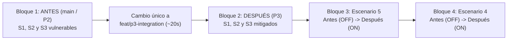

# Guía de Demostración en Vivo — 5 Escenarios de Seguridad (Antes vs. Después)

Esta guía está diseñada para la sustentación en clase de **GeoPicto (Prototype 3)**, permitiendo mostrar en vivo al profesor **la vulnerabilidad original (Antes)** y **la contramedida implementada (Después)** en los **5 escenarios de seguridad** sin perder tiempo compilando imágenes frente al público.

---

## 1. Estrategia y Orden Óptimo de la Sustentación (~8–10 min)

Para evitar cambiar de rama múltiples veces o bloquear tus propias pruebas por el *rate limiting*:



> [!TIP]
> **¿Por qué el Escenario 5 va antes del Escenario 4?**
> Porque el Escenario 4 en modo protegido agota intencionalmente la cuota de `POST /api/auth/login` (10 intentos/min por IP). Si corres primero el Escenario 5, nunca chocas contra un `429` accidental y no tienes que esperar 1 minuto en medio de la exposición.

---

## 2. Preparación Previa (5 minutos antes de pasar al frente)

Usa un **`git worktree` temporal** con nombre de proyecto Docker distinto (`-p geopicto-p2`) para pre-compilar las imágenes de `main` **sin pisar** las imágenes de `feat/p3-integration`. Así el salto de P2 → P3 en vivo toma solo ~20 segundos (sin `--build`).

```bash
# Desde la raíz del repositorio (swarch-project)

# 1. Asegurar que feat/p3-integration tiene certificados e imágenes ya compiladas
git checkout feat/p3-integration
./scripts/generate-certs.sh
docker compose build

# 2. Crear una copia ligera de main (P2) al lado y pre-compilar sus imágenes con otro proyecto (-p)
git worktree add ../swarch-p2-main main
(cd ../swarch-p2-main && docker compose -p geopicto-p2 --env-file /dev/null build)

# 3. Dejar P2 (main) ya levantado y listo para arrancar la demo mostrando las vulnerabilidades
docker compose down
(cd ../swarch-p2-main && docker compose -p geopicto-p2 --env-file /dev/null up -d --wait)
```

> [!IMPORTANT]
> Usa siempre `--env-file /dev/null` al operar sobre `main` (`../swarch-p2-main`), para que el archivo `.env` local (configurado para HTTPS de P3) no interfiera con las URLs HTTP de P2.

---

## 3. Bloque 1 — Demostrar las Debilidades (ANTES: `main` / Prototipo 2)

Con `geopicto-p2` ya levantado, ejecuta todo desde tu carpeta principal (`swarch-project` en `feat/p3-integration`) para reutilizar los scripts de prueba directamente contra el sistema vulnerable.

### Escenario 1 (ANTES) — Tráfico en texto plano (sin TLS ni HSTS)

```bash
# 1. El API Gateway responde en HTTP sin cifrar por :8080 (credenciales, JWT y GPS en texto plano)
curl -i "http://localhost:8080/api/messages/nearby?lat=4.6371&lng=-74.0834&radius=500"

# 2. No existe canal HTTPS en :443 ni redirección desde :80
curl -skI https://localhost/ || echo "SIN HTTPS (:443 rechazado)"
curl -sI http://localhost/   || echo "SIN redireccion HTTP :80 -> HTTPS"

# 3. El panel SSR (:8082) sirve por HTTP sin flag Secure ni HSTS
curl -sI http://localhost:8082/login
```

**Qué señalar al profesor:**
* El tráfico viaja en `http://` y `ws://` sin cifrado (vulnerable a *Eavesdropping* / *MitM*).
* No hay puerto `:443`, no hay redirección `301` ni cabecera `Strict-Transport-Security` (HSTS).

---

### Escenario 2 (ANTES) — Múltiples puertos expuestos y sin hardening perimetral

El script `scripts/test-reverse-proxy.sh` detecta automáticamente que no hay proxy y audita los puertos directos:

```bash
./scripts/test-reverse-proxy.sh
```

**Qué señalar al profesor (todo sale en rojo `[EXPUESTO]`):**
* **3 puertos de aplicación abiertos al host:** `gateway` (`:8080`), `frontend` (`:8081`) y `profile-web` (`:8082`), además de `mailpit` (`:8025`).
* **Fuga de versiones/tecnología:** `Server: nginx/1.x.x` en `:8081` y `X-Powered-By: Next.js` en `:8082`.
* **0 cabeceras de seguridad:** faltan `X-Frame-Options`, `X-Content-Type-Options` y `Referrer-Policy`.
* **Sin límite de tamaño en el borde:** un payload de **7 MB** atraviesa el gateway y golpea directamente al microservicio `auth` (responde `422` en vez de `413`).

---

### Escenario 3 (ANTES) — Red plana sin segmentación (Movimiento Lateral)

Demuestra en vivo que un contenedor de borde comprometido (`frontend` o `gateway`) tiene acceso TCP directo a las bases de datos y servicios internos:

```bash
# Desde el contenedor FRONTEND (capa de presentación) alcanzamos directamente auth-db y rabbitmq:
docker compose -p geopicto-p2 -f ../swarch-p2-main/docker-compose.yml exec frontend nc -zv -w 2 auth-db 5432
docker compose -p geopicto-p2 -f ../swarch-p2-main/docker-compose.yml exec frontend nc -zv -w 2 messages-db 5432
docker compose -p geopicto-p2 -f ../swarch-p2-main/docker-compose.yml exec frontend nc -zv -w 2 rabbitmq 5672

# Desde el contenedor AUTH alcanzamos la base de datos de OTRO microservicio (messages-db):
docker compose -p geopicto-p2 -f ../swarch-p2-main/docker-compose.yml exec auth \
  python -c "import socket; s=socket.create_connection(('messages-db', 5432), timeout=2); print('EXPUESTO: auth alcanzó messages-db:5432'); s.close()"
```

**Qué señalar al profesor:**
* Todos los contenedores comparten una sola red bridge (`default`).
* Si un atacante compromete el frontend o un microservicio, puede conectarse directamente a las 8 bases de datos, Redis, MinIO y RabbitMQ (*Lateral Movement*).

---

## 4. Transición a Prototipo 3 (`feat/p3-integration`, ~20 s)

Apaga el stack P2 y levanta el stack endurecido P3 (las imágenes ya están compiladas):

```bash
(cd ../swarch-p2-main && docker compose -p geopicto-p2 down)
docker compose up -d --wait
docker compose ps --format "table {{.Service}}\t{{.Status}}\t{{.Ports}}"
```

**Qué señalar al profesor en `docker compose ps`:**
* **25 / 25 contenedores `healthy`**.
* En la columna `PORTS`, **solo `reverse-proxy` publica puertos (`80` y `443`)**. `gateway`, `frontend`, `profile-web` y `mailpit` ya no exponen ningún puerto al host.

---

## 5. Bloque 2 — Solución de Escenarios 1, 2 y 3 (DESPUÉS: `feat/p3-integration`)

### Escenario 1 (DESPUÉS) — Secure Channel Pattern (TLS 1.2/1.3, HSTS, WSS)

```bash
# 1. Prueba rápida visual: HTTP :80 fuerza redirección 301 a HTTPS
curl -sI "http://localhost/api/messages/nearby?lat=4.6371&lng=-74.0834&radius=500"

# 2. Prueba HTTPS validando la CA local (sin -k) y verificando HSTS
curl --cacert nginx/certs/ca.pem -sI https://localhost/healthz

# 3. Suite automatizada completa del Escenario 1 (21/21 PASS)
./scripts/test-secure-channel.sh --require-live
```

**Qué señalar al profesor:**
* `301 Moved Permanently` desde `:80` hacia `https://`.
* Negociación real de **TLS 1.3** (`TLS_AES_256_GCM_SHA384`) y **TLS 1.2** (`ECDHE-RSA-AES256-GCM-SHA384`) validada contra nuestra CA local (`ca.pem`).
* Rechazo explícito de **TLS 1.0**, **TLS 1.1**, HTTP plano en `:443` y clientes sin CA confiable.
* `Strict-Transport-Security` (HSTS) activo en `:443` y canal WebSocket cifrado (`wss://localhost/api/ws` → `HTTP 101`).

---

### Escenario 2 (DESPUÉS) — Reverse Proxy Pattern (Perímetro Unificado)

```bash
./scripts/test-reverse-proxy.sh
```

**Qué señalar al profesor (mismo script que antes dio rojo, ahora 100 % verde):**
* `EXPUESTO: 0 · MITIGADO: 10 · FALLA: 0`.
* Puertos `8080`, `8081` y `8082`: **conexión rechazada** (solo 1 punto de entrada: `reverse-proxy`).
* `Server: nginx` (sin versión) y `X-Powered-By` eliminado.
* `X-Frame-Options: DENY`, `X-Content-Type-Options: nosniff` y `Referrer-Policy` en todas las respuestas.
* Cuerpo de **7 MB rechazado en el borde con `413`** (0 bytes llegan a `auth`).
* Todas las rutas (`/`, `/login`, `/account?demo=1`, `/_next/`, `/_expo/`, `/api/`, `/api/ws`) operan desde un solo origen HTTPS.

---

### Escenario 3 (DESPUÉS) — Network Segmentation Pattern (12 Redes, 11 `internal: true`)

```bash
# 1. Repetir las mismas 2 pruebas de ataque que antes tuvieron éxito — ahora BLOQUEADAS:
docker compose exec frontend nc -zv -w 2 auth-db 5432 || echo "MITIGADO: frontend bloqueado hacia auth-db"
docker compose exec auth python -c "import socket; socket.create_connection(('messages-db', 5432), timeout=2)" \
  || echo "MITIGADO: auth bloqueado hacia messages-db"

# 2. Suite completa de matriz positiva y negativa (85/85 PASS, 0 SKIP)
./scripts/test-network-segmentation.sh
```

**Qué señalar al profesor:**
* **34 pruebas positivas PASS:** cada servicio alcanza únicamente lo autorizado (`edge_net`, `gateway_net`, `broker_net`, `redis_net` y su propia `*_db_net`).
* **51 pruebas negativas PASS:** `reverse-proxy`, `frontend`, `profile-web` y `gateway` no pueden resolver ni conectar a ninguna base de datos; `gateway` tampoco alcanza a `moderation:8080`, `email:8080` ni `rabbitmq:5672`; los 7 servicios que no usan Redis no pueden conectar a `redis:6379`; ningún microservicio alcanza la BD de otro; ninguna BD alcanza a otra BD.

---

## 6. Bloque 3 — Escenario 5 en Vivo: Token Revocation Blacklist (Antes → Después)

Se alterna en segundos mediante la variable compartida `TOKEN_BLACKLIST_ENABLED` (en `auth` y `gateway`), sin cambiar de rama.

### Paso 1: ANTES (Vulnerable — `TOKEN_BLACKLIST_ENABLED=false`)

```bash
TOKEN_BLACKLIST_ENABLED=false docker compose up -d --force-recreate --wait auth gateway
NODE_EXTRA_CA_CERTS="$PWD/nginx/certs/ca.pem" node scripts/test-token-revocation.mjs --mode off
```

**Qué señalar al profesor:**
* El usuario hace `POST /api/auth/logout` (`200 OK`), pero al reutilizar el mismo JWT inmediatamente en `GET /api/profiles/me`, el gateway lo **ACEPTA (`200 OK`)** — demostrando la ventana de *Token Replay* de 15 minutos.

### Paso 2: DESPUÉS (Mitigado — `TOKEN_BLACKLIST_ENABLED=true`)

```bash
TOKEN_BLACKLIST_ENABLED=true docker compose up -d --force-recreate --wait auth gateway
NODE_EXTRA_CA_CERTS="$PWD/nginx/certs/ca.pem" node scripts/test-token-revocation.mjs --mode on
```

**Qué señalar al profesor:**
* El mismo `access_token` sirve antes del logout (`200`), pero tras `POST /api/auth/logout` es **rechazado al instante con `401 Unauthorized`** en el gateway.
* El script inspecciona directamente **Redis DB 1** y muestra la clave `auth:revoked:sid:<sid> -> 1` con `TTL ~900 s` (expiración automática al vencer el token, sin fuga de memoria).
* Una nueva sesión del mismo usuario sigue funcionando normalmente (`200`).

---

## 7. Bloque 4 — Escenario 4 en Vivo: Rate Limiting / Throttling (Antes → Después)

Se alterna en segundos con `RATE_LIMIT_ENABLED` en `gateway`.

### Paso 1: ANTES (Vulnerable — `RATE_LIMIT_ENABLED=false`)

```bash
RATE_LIMIT_ENABLED=false docker compose up -d --force-recreate --wait gateway
NODE_EXTRA_CA_CERTS="$PWD/nginx/certs/ca.pem" node scripts/test-rate-limit.mjs --mode vulnerable
```

**Qué señalar al profesor:**
* **0 respuestas `429`:**
  * Ataque 1 (spam de escritura): los **30/30** mensajes de spam se guardan en PostgreSQL y disparan eventos RabbitMQ.
  * Ataque 2 (fuerza bruta en login): los **30/30** intentos golpean Argon2id en `auth`; el script calcula que un diccionario de 10.000 contraseñas tomaría apenas **~50 segundos**.
  * Ataque 3 (flood geoespacial): las **150/150** consultas golpean PostGIS sin freno.

### Paso 2: DESPUÉS (Mitigado — `RATE_LIMIT_ENABLED=true`)

```bash
RATE_LIMIT_ENABLED=true docker compose up -d --force-recreate --wait gateway
NODE_EXTRA_CA_CERTS="$PWD/nginx/certs/ca.pem" node scripts/test-rate-limit.mjs --mode protected
```

**Qué señalar al profesor:**
* El filtro reactivo con **script Lua atómico de Token Bucket en Redis DB 1** frena las 3 ráfagas directamente en el gateway con **`429 Too Many Requests`**, `Retry-After` y `X-RateLimit-Remaining: 0` (latencia ~16 ms, sin tocar microservicios ni bases de datos).
* El ataque de diccionario de 10.000 contraseñas pasa de **~50 segundos a ~16.7 horas**.
* **Aislamiento entre usuarios:** mientras el atacante recibe `429`, otro usuario legítimo (`victim`) sigue publicando mensajes con **`201 Created`** sin degradación.

---

## 8. Cierre Opcional: Prueba Integral E2E sobre el Sistema Endurecido

Para demostrar que los 5 patrones de seguridad no rompieron ninguna funcionalidad de GeoPicto (espera ~1 min tras el Escenario 4 para que se recargue la cuota de auth, o corre primero si prefieres):

```bash
NODE_EXTRA_CA_CERTS="$PWD/nginx/certs/ca.pem" node scripts/smoke-test.mjs
NODE_EXTRA_CA_CERTS="$PWD/nginx/certs/ca.pem" node scripts/test-realtime.mjs
```

Resultado esperado: **52/52 OK** en `smoke-test.mjs` (incluyendo cookies `HttpOnly; Secure` en `/login` y avatares HTTPS sin *Mixed Content*) y **19/19 OK** en `test-realtime.mjs` (`wss://localhost/api/ws` en vivo).

---

## 9. Consejos y Limpieza Post-Presentación

> [!CAUTION]
> **Si repites el Escenario 4 o el `smoke-test` justo después del Escenario 4 en modo `protected`:** la cuota de `POST /api/auth/register` es de **10 req/min por IP**. Si te sale `429` al registrar usuarios de prueba, simplemente limpia los contadores de rate-limit en Redis en 1 segundo:
> ```bash
> docker compose exec redis redis-cli -n 1 FLUSHDB
> ```

**Al terminar la presentación (limpieza del worktree temporal):**

```bash
(cd ../swarch-p2-main && docker compose -p geopicto-p2 down -v)
git worktree remove ../swarch-p2-main
docker compose down
```
