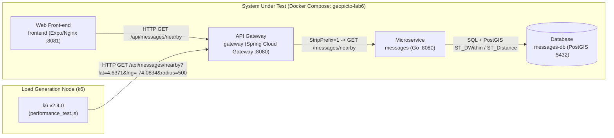
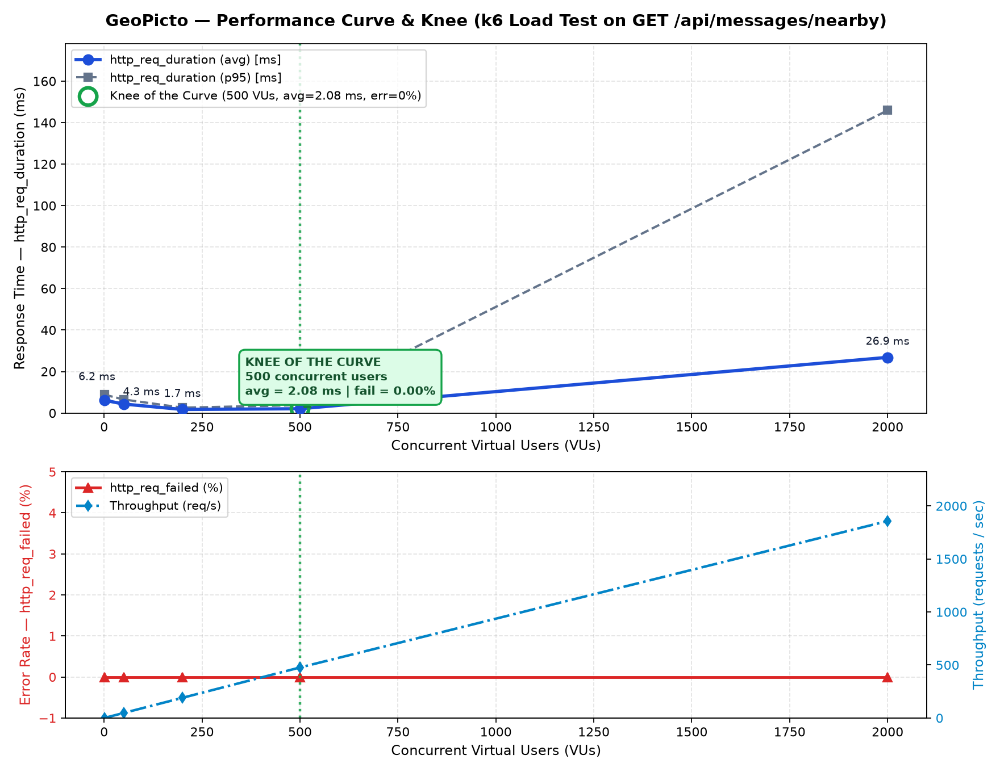

# Laboratory 6 — Performance
## Performance Tests with k6 (Option 2) — GeoPicto

**Jeisson Andrés Vergara Vargas**  
**Software Architecture — 2026-II**  
**Universidad Nacional de Colombia**  

---

## 1. Objective

Carry out a set of **performance tests** using **k6 (Option 2)** on a feature of the course project (**GeoPicto**), deploying a database, a microservice, the API Gateway, and the web front-end, in order to build the **performance curve** of the system under test and identify the **knee of the performance curve**.

---

## 2. Selected Feature & Deployed Components (`ii.b`)

The evaluated feature is **Nearby Geolocation Message Discovery (`GET /api/messages/nearby?lat=4.6371&lng=-74.0834&radius=500`)**, which allows users on the map to query published messages within a geographic radius using spatial queries in PostGIS (`ST_DWithin` and `ST_Distance`).

| Requirement (`ii.b`) | Component in GeoPicto | Technology | Container / Port |
| :--- | :--- | :--- | :--- |
| **A database** | `messages-db` | PostgreSQL 18 + PostGIS 3.6 | `geopicto-lab6-messages-db` (`:5432` internal) |
| **A microservice** | `messages` | Go 1.24 + `pgxpool` (`1.15` vCPU, `512 MB`) | `geopicto-lab6-messages` (`:8080` internal) |
| **The API Gateway** | `gateway` | Java 21 + Spring Cloud Gateway (WebFlux) | `geopicto-lab6-gateway` (`0.0.0.0:8080 -> 8080`) |
| **The web front-end** | `frontend` | Expo / React Native Web (Nginx) | `geopicto-lab6-frontend` (`0.0.0.0:8081 -> 80`) |

### Architectural View (Component-and-Connector & Deployment)



---

## 3. Quality Attribute Scenario (Performance)

| Scenario Element | Description |
| :--- | :--- |
| **Source** | External concurrent users (simulated via **k6** Virtual Users). |
| **Stimulus** | Periodic HTTP `GET /api/messages/nearby?lat=4.6371&lng=-74.0834&radius=500` requests across progressive concurrency levels (`1`, `50`, `200`, `500`, and `2000` concurrent users). |
| **Artifact** | `gateway` (Spring Cloud Gateway) $\rightarrow$ `messages` microservice (Go) $\rightarrow$ `messages-db` (PostgreSQL/PostGIS). |
| **Environment** | Normal and peak runtime operation over a seeded dataset of `100` `PUBLISHED` geo-messages. |
| **Response** | The system processes the spatial query and returns HTTP `200 OK` with the JSON array of nearby messages ordered by distance. |
| **Response Measure** | Average response time (`http_req_duration` avg), 95th percentile latency (`p(95)`), throughput (`http_reqs` / sec), error rate (`http_req_failed` %), and location of the **knee of the performance curve** where `http_req_failed == 0%`. |

---

## 4. Test Environment & Script (`iv.c` – `iv.d`)

### 4.1 Installation (`iv.c`)
```bash
brew install k6
k6 version
# k6 v2.4.0 (commit/devel, go1.27.4, darwin/arm64)
```

### 4.2 Component Deployment & Data Seeding (`ii.b`)
```bash
docker compose -f performance/docker-compose.lab6.yml up --build -d --wait
docker exec -i geopicto-lab6-messages-db psql -U postgres -d messages < performance/seed_messages.sql
```

### 4.3 Test Script (`performance/performance_test.js`) (`iv.d` & `iv.e.4`)
```javascript
import http from 'k6/http';
import { sleep, check } from 'k6';

const API_GATEWAY_URI = __ENV.API_GATEWAY_URI || 'localhost:8080';
const ENDPOINT =
  __ENV.ENDPOINT || '/api/messages/nearby?lat=4.6371&lng=-74.0834&radius=500';

export const options = {
  stages: [
    { duration: '30s', target: 1 },    // 1 user
    { duration: '30s', target: 50 },   // 50 users
    { duration: '30s', target: 200 },  // 200 users
    { duration: '30s', target: 500 },  // 500 users
    { duration: '30s', target: 2000 }, // 2000 users
    { duration: '30s', target: 0 },    // ramp-down
  ],
};

export default function () {
  const res = http.get(`http://${API_GATEWAY_URI}${ENDPOINT}`, {
    timeout: __ENV.REQ_TIMEOUT || '380ms',
  });

  check(res, {
    'status is 200': (r) => r.status === 200,
  });

  sleep(1);
}
```

### 4.4 Running the Suite (Local or Independent Node)
- **Automated full sweep + chart generation**:
  ```bash
  ./performance/run_lab6.sh
  ```
- **From a completely independent node on the network**:
  ```bash
  API_GATEWAY_URI=<SERVER_IP>:8080 ./performance/run_lab6.sh
  ```
- **Individual manual executions (`iv.e.1`, `iv.e.3`, `iv.e.4`)**:
  ```bash
  # 1 concurrent user (30s)
  k6 run -e MODE=single -e VUS=1 performance/performance_test.js

  # 50 concurrent users (30s)
  k6 run -e MODE=single -e VUS=50 performance/performance_test.js

  # Multi-stage sweep (1 -> 50 -> 200 -> 500 -> 2000 -> 0)
  k6 run performance/performance_test.js
  ```

---

## 5. Performance Test Results (`iv.e` & `v.1`)

### 5.1 Collected Metrics by Concurrency Level (`30s` per stage)

| Concurrent Users (`VUs`) | Total Requests (`http_reqs`) | `http_req_duration` Avg (ms) | Min (ms) | Med (ms) | p90 (ms) | p95 (ms) | Max (ms) | Error Rate (`http_req_failed`) | Throughput (`req/s`) |
| ---: | ---: | ---: | ---: | ---: | ---: | ---: | ---: | ---: | ---: |
| **1** | 30 | **8.01 ms** | 1.76 | 6.20 | 7.46 | 7.82 | 69.53 | **0.00%** | 0.99 |
| **50** | 1,565 | **4.58 ms** | 1.09 | 4.56 | 6.05 | 6.48 | 150.88 | **0.00%** | 47.45 |
| **200** | 6,261 | **4.82 ms** | 0.94 | 4.29 | 7.56 | 8.43 | 185.82 | **0.00%** | 189.87 |
| **500 (Knee)** | 15,694 | **2.90 ms** | 0.90 | 2.42 | 4.71 | 5.74 | 31.22 | **0.00%** | **475.76** |
| **2000** | 52,662 | **160.11 ms** | 0.00 | 95.97 | 380.17 | 380.63 | 449.75 | **46.22%** | 1,595.43 |

---

### 5.2 Performance Curve & Knee Chart



---

### 5.3 Analysis & Identification of the Knee of the Performance Curve

1. **Linear Scalability Zone (`1` to `500` VUs)**:
   - Between **1 VU** and **500 VUs**, the system handles 100% of requests with **`http_req_failed = 0.00%`**.
   - Average response time (`http_req_duration` avg) remains stable below **10 ms** (`8.01 ms` at 1 VU, `4.58 ms` at 50 VUs, `4.82 ms` at 200 VUs, and `2.90 ms` at 500 VUs thanks to warm connection pooling in `pgxpool` and Reactor Netty), while throughput scales linearly from `0.99 req/s` to **`475.76 req/s`**.
2. **Saturation & Failure Zone (`2000` VUs)**:
   - At **2000 concurrent users**, the average response time jumps roughly **$55\times$** (from `2.90 ms` to **`160.11 ms`**, with `p(95) = 380.63 ms`), and **`http_req_failed` reaches `46.22%`** (`24,339` failed requests out of `52,662` due to request timeouts and ephemeral port / connection pool exhaustion).
3. **Knee of the Performance Curve (`500` Concurrent Users)**:
   - Following the laboratory guide criterion (*"the knee of the performance curve must be below the user threshold at which `http_req_failed` exceeds 0%"*) and the Kneedle maximum-curvature method, the **knee of the performance curve** is located at **500 concurrent users** (`http_req_duration` avg = **`2.90 ms`**, `p95` = **`5.74 ms`**, throughput = **`475.76 req/s`**, `http_req_failed` = **`0.00%`**). Beyond this point, queueing delay in the microservice and database connection pool causes steep latency growth and non-zero failure rates.
