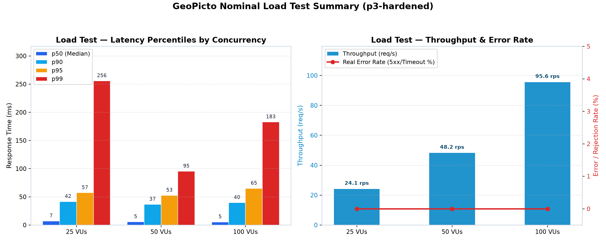
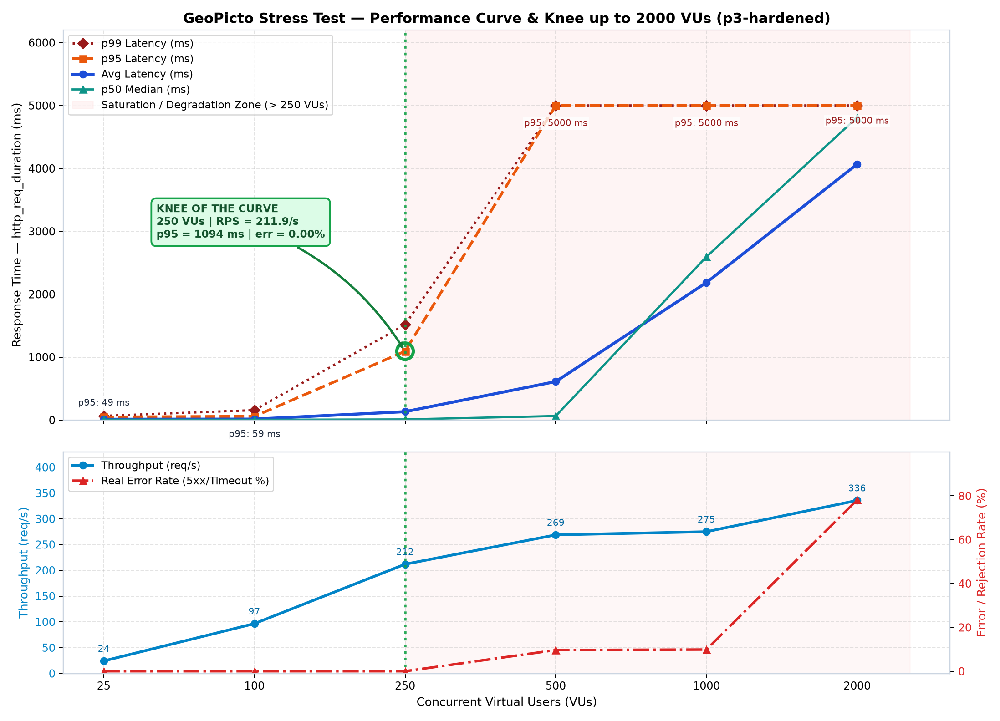
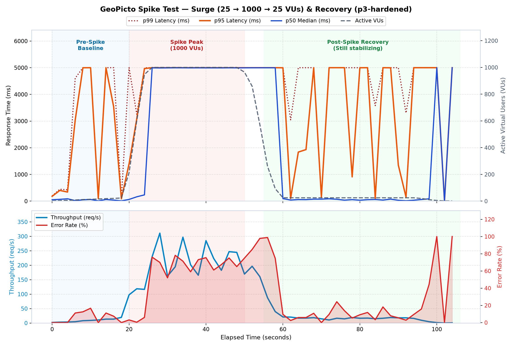
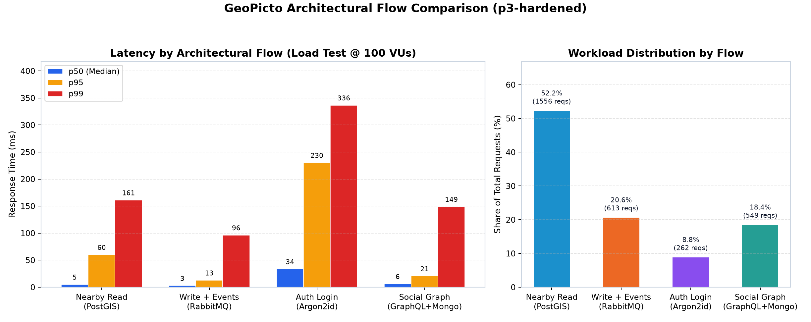
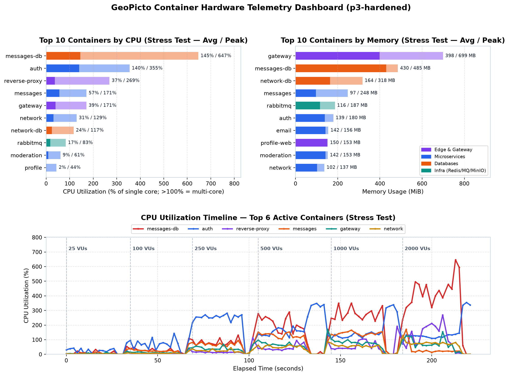

# Performance & Scalability Analysis — GeoPicto (`p3-hardened`)

This section presents the empirical performance evaluation of **GeoPicto** under nominal load, progressive stress up to high concurrency, and sudden traffic spikes, together with per-container hardware telemetry (`CPU %`, `RAM`, and `Network I/O`) and architectural bottleneck identification.

## 1. Test Environment & Tools

| Parameter | Value |
| :--- | :--- |
| **Run Label / Git Branch** | `p3-hardened` (`feat/p3-integration` @ `b11ec29`) |
| **Target Endpoint & Protocol** | `https://localhost` (`HTTPS`) |
| **Reverse Proxy Detected** | `Yes (Nginx Edge)` |
| **Rate Limiting State** | `disabled` |
| **Active Docker Containers** | `25` containers (Compose project `geopicto`) |
| **Host Machine** | Darwin 27.2.0 (arm64) — Apple M5 (10 logical cores, 16.0 GB RAM) |
| **Docker Engine Resources** | Docker version 29.9.3, build 5457199 (Allocated: 10 vCPUs, 7.75 GB RAM) |
| **Load Generator & Telemetry** | `k6 v2.4.0 (commit/devel, go1.27.4, darwin/arm64)` · Docker `stats` collector (`collect-metrics.sh`) · Python `3.14.7` (`matplotlib`/`numpy`) |

## 2. Performance Quality Attribute Scenario

| Scenario Element | Description |
| :--- | :--- |
| **Source** | External concurrent GeoPicto clients simulated via **k6** Virtual Users (VUs). |
| **Stimulus** | Mixed realistic workload (50% PostGIS `GET /api/messages/nearby`, 20% GraphQL `POST /api/network/graphql`, 20% writes `POST /api/messages` & `PUT /api/ratings/messages/:id`, 10% `POST /api/auth/login`) across **Load** (nominal concurrency), **Stress** (up to **2000 VUs**), and **Spike** (abrupt traffic surge & recovery) profiles. |
| **Artifact** | End-to-end hardened GeoPicto stack (`reverse-proxy` → `gateway` → `auth`, `messages`, `moderation`, `rating`, `reputation`, `network` → PostgreSQL/PostGIS, MongoDB, Redis, RabbitMQ). |
| **Environment** | Normal steady-state operation, progressive saturation ramp, and sudden traffic surge over seeded datasets of users, published geo-messages, and friendships. |
| **Response** | The system processes requests through the perimeter Reverse Proxy, API Gateway security filters, domain microservices, and backing data stores while maintaining bounded tail latency and graceful recovery after spikes. |
| **Response Measure** | Latency percentiles (`p50`, `p90`, `p95`, `p99`), sustained throughput (`req/s`), real error rate (`5xx`/timeout `%` separated from `HTTP 429`), **Knee of the Performance Curve**, spike recovery time (`s`), and container `CPU %` / `RAM (MiB)`. |

## 3. Load Test Results (Nominal Concurrency)

| VUs | Requests | Throughput (req/s) | Avg (ms) | p50 (ms) | p90 (ms) | p95 (ms) | p99 (ms) | Max (ms) | Real Error (%) | HTTP 429 (%) |
| ---: | ---: | ---: | ---: | ---: | ---: | ---: | ---: | ---: | ---: | ---: |
| 25 | 748 | 24.14 | 19.15 | 7.08 | 41.60 | 57.14 | 255.73 | 323.48 | 0.00% | 0.00% |
| 50 | 1500 | 48.23 | 13.97 | 5.48 | 36.58 | 52.53 | 95.25 | 384.63 | 0.00% | 0.00% |
| 100 | 2980 | 95.60 | 16.68 | 5.24 | 39.71 | 64.93 | 182.72 | 385.36 | 0.00% | 0.00% |

## 4. Stress Test Results & Knee of the Performance Curve

| VUs | Requests | Throughput (req/s) | Avg (ms) | p50 (ms) | p90 (ms) | p95 (ms) | p99 (ms) | Max (ms) | Real Error (%) | HTTP 429 (%) |
| ---: | ---: | ---: | ---: | ---: | ---: | ---: | ---: | ---: | ---: | ---: |
| 25 | 750 | 24.24 | 12.80 | 5.90 | 35.65 | 48.67 | 66.41 | 132.59 | 0.00% | 0.00% |
| 100 | 3009 | 96.61 | 15.34 | 4.86 | 37.49 | 58.80 | 157.13 | 423.01 | 0.00% | 0.00% |
| 250 **(Knee)** | 6729 | 211.87 | 133.03 | 10.24 | 539.79 | 1093.60 | 1516.10 | 2327.02 | 0.00% | 0.00% |
| 500 | 9707 | 268.78 | 611.58 | 64.10 | 1343.30 | 5000.11 | 5000.47 | 5002.39 | 9.67% | 0.00% |
| 1000 | 9938 | 274.89 | 2184.97 | 2595.19 | 3675.74 | 5000.10 | 5000.32 | 5005.80 | 9.90% | 0.00% |
| 2000 | 12137 | 335.59 | 4067.28 | 4810.93 | 5000.18 | 5000.31 | 5000.72 | 5016.50 | 78.12% | 0.00% |

- **Detected Knee of the Performance Curve:** **250 concurrent VUs** (Throughput = **211.87 req/s**, `p95` = **1093.60 ms**, `p99` = **1516.10 ms**, Real Error Rate = **0.00%**).
- **Peak Observed Throughput:** **335.59 req/s** at **2000 VUs**.
- **Degradation / Error Onset:** Real errors (`5xx` / timeouts) surpassed the 1% SLO budget at **500 VUs** (**9.67%**).

## 5. Spike Test & Recovery Resilience

The spike profile subjected GeoPicto to an abrupt surge from **25 VUs** to **1000 VUs** (40x burst) for **25s**, followed by an immediate drop back to **25 VUs** for **40s** of recovery observation.

| Spike Phase | Avg VUs | Max VUs | Avg RPS | Peak RPS | Avg (ms) | p50 (ms) | p95 (ms) | Peak p99 (ms) | Avg Err (%) | Peak Err (%) |
| :--- | ---: | ---: | ---: | ---: | ---: | ---: | ---: | ---: | ---: | ---: |
| Pre-Spike (Baseline) | 30.6 | 212 | 16.77 | 97.50 | 353.02 | 52.48 | 5000.22 | 5001.18 | 5.63% | 16.67% |
| Spike Peak | 967.7 | 1000 | 209.90 | 311.00 | 3182.58 | 4993.69 | 5000.89 | 5010.32 | 60.34% | 78.15% |
| Post-Spike (Recovery) | 33.7 | 260 | 17.92 | 87.50 | 1254.87 | 62.18 | 5001.13 | 5001.33 | 23.56% | 100.00% |

- **Measured Recovery Time:** Latency or error rate had not fully returned to baseline within the observation window, indicating lingering queue/connection backlog after the surge.

## 6. Per-Flow Latency Breakdown (Load Test @ 100 VUs)

| Architectural Flow | Requests | Avg (ms) | p50 (ms) | p90 (ms) | p95 (ms) | p99 (ms) | Max (ms) |
| :--- | ---: | ---: | ---: | ---: | ---: | ---: | ---: |
| GET /api/messages/nearby (PostGIS spatial query) | 1556 | 15.44 | 4.96 | 42.71 | 60.02 | 161.05 | 274.23 |
| POST /api/messages & PUT /api/ratings/:id (DB + RabbitMQ) | 613 | 5.58 | 2.78 | 6.68 | 12.77 | 96.19 | 180.45 |
| POST /api/auth/login (Argon2id password hash) | 262 | 60.10 | 33.53 | 124.31 | 230.30 | 336.45 | 385.36 |
| POST /api/network/graphql (GraphQL + MongoDB) | 549 | 11.84 | 6.22 | 12.70 | 20.52 | 148.88 | 164.36 |

## 7. Container Hardware Resource Utilization (Stress Test)

| Container | Tier | Avg CPU (%) | Peak CPU (%) | Avg RAM (MiB) | Peak RAM (MiB) | Net RX Δ (MB) | Net TX Δ (MB) | Peak PIDs |
| :--- | :--- | ---: | ---: | ---: | ---: | ---: | ---: | ---: |
| `messages-db` | Databases | 145.2% | **646.9%** | 429.7 | 485.2 | 19.07 | 4832.00 | 27 |
| `auth` | Microservices | 140.3% | **354.6%** | 138.6 | 179.9 | 4.92 | 5.68 | 36 |
| `reverse-proxy` | Edge & Gateway | 37.2% | **269.1%** | 63.2 | 134.8 | 9570.00 | 9390.00 | 17 |
| `messages` | Microservices | 56.7% | **171.2%** | 96.5 | 247.9 | 4858.00 | 9310.00 | 20 |
| `gateway` | Edge & Gateway | 39.4% | **171.2%** | 398.4 | 699.3 | 9300.00 | 9300.00 | 62 |
| `network` | Microservices | 30.9% | **129.5%** | 102.1 | 136.9 | 26.81 | 17.38 | 46 |
| `network-db` | Databases | 24.0% | **117.1%** | 163.6 | 317.6 | 7.99 | 17.89 | 162 |
| `rabbitmq` | Infra (Redis/MQ/MinIO) | 17.4% | **83.4%** | 115.9 | 187.0 | 21.19 | 32.84 | 79 |
| `moderation` | Microservices | 9.1% | **60.8%** | 142.2 | 152.8 | 5.11 | 6.98 | 9 |
| `profile` | Microservices | 2.2% | **44.0%** | 103.3 | 116.9 | 0.02 | 0.03 | 16 |
| `email` | Microservices | 2.4% | **37.2%** | 141.8 | 155.5 | 0.03 | 0.03 | 10 |
| `socket-gateway` | Microservices | 5.0% | **25.4%** | 119.6 | 122.3 | 29.11 | 18.03 | 42 |
| `moderation-db` | Databases | 2.4% | **17.0%** | 37.9 | 40.7 | 3.65 | 2.31 | 14 |
| `rating` | Microservices | 3.4% | **16.6%** | 15.4 | 21.1 | 11.83 | 12.06 | 17 |
| `minio` | Infra (Redis/MQ/MinIO) | 1.1% | **14.9%** | 82.8 | 95.4 | 0.01 | 0.01 | 24 |
| `reputation-db` | Databases | 3.7% | **14.7%** | 39.9 | 43.3 | 11.29 | 8.24 | 11 |
| `reputation` | Microservices | 3.9% | **14.3%** | 54.3 | 55.4 | 15.49 | 18.63 | 23 |
| `rating-db` | Databases | 3.0% | **12.4%** | 53.2 | 56.2 | 6.62 | 5.21 | 19 |
| `redis` | Infra (Redis/MQ/MinIO) | 2.0% | **10.5%** | 9.5 | 10.4 | 17.08 | 14.35 | 6 |
| `auth-db` | Databases | 2.1% | **8.3%** | 51.0 | 62.7 | 3.59 | 2.50 | 27 |
| `profile-web` | Edge & Gateway | 0.2% | **6.4%** | 150.3 | 153.3 | 0.00 | 0.00 | 11 |
| `mailpit` | Infra (Redis/MQ/MinIO) | 0.5% | **6.0%** | 38.4 | 42.6 | 0.01 | 0.02 | 15 |
| `profile-db` | Databases | 0.4% | **3.3%** | 28.9 | 30.1 | 0.01 | 0.01 | 11 |
| `email-db` | Databases | 0.3% | **2.8%** | 26.5 | 28.4 | 0.01 | 0.01 | 13 |
| `frontend` | Edge & Gateway | 0.1% | **2.5%** | 17.0 | 18.4 | 0.00 | 0.00 | 11 |

## 8. Critical Architectural Bottleneck Analysis & Conclusions

1. **Highest-Latency Flow:** `POST /api/auth/login (Argon2id password hash)` exhibited the highest tail latency (`p95` = **230.30 ms**, `p99` = **336.45 ms**), compared to the fastest flow `POST /api/messages & PUT /api/ratings/:id (DB + RabbitMQ)` (`p95` = **12.77 ms**).
2. **Primary CPU Bottleneck:** Container `messages-db` reached the highest CPU peak (**646.9%**, avg **145.2%**). PostGIS `ST_DWithin` / `ST_Distance` spatial index scans over `GEOGRAPHY(Point, 4326)` combined with concurrent inserts pressure CPU and shared buffers.
3. **Primary Memory Consumer:** Container `gateway` consumed the highest memory footprint (**699.3 MiB** peak, **398.4 MiB** avg).
4. **Secondary Contention Points:**
   - **`auth` (Peak CPU 354.6%):** Argon2id password verification is intentionally CPU- and memory-hard, making `auth` saturate CPU early under concurrent login requests.
   - **`reverse-proxy` (Peak CPU 269.1%):** Nginx edge TLS 1.2/1.3 handshake/encryption and reverse-proxy connection multiplexing add measurable CPU overhead at high VU counts (Scenarios 1 & 2).
   - **`messages` (Peak CPU 171.2%):** High concurrency on geospatial queries and message publication drives Go goroutine scheduling, `pgxpool` contention, and RabbitMQ publishing.
5. **Capacity Ceiling & Scaling Recommendations:** The single-node Docker deployment maintains reliable SLOs up to the **knee at 250 concurrent VUs (211.9 req/s)**. Beyond this threshold, queuing delays and timeouts grow sharply. To scale beyond 250 VUs in production:
   - Horizontally replicate stateless hot-path services (`gateway`, `auth`, `messages`, `network`) behind Nginx load balancing.
   - Introduce read replicas or spatial query caching (Redis geospatial cache) for `GET /api/messages/nearby` hotspots.
   - Tune PostgreSQL `max_connections` / `pgxpool` sizing and decouple write-heavy vote aggregation in `rating` to minimize `SELECT ... FOR UPDATE` lock contention.
   - Keep Redis-backed **Rate Limiting (Scenario 4)** enabled in production so abusive traffic sheds cleanly with `HTTP 429` before reaching CPU saturation.
